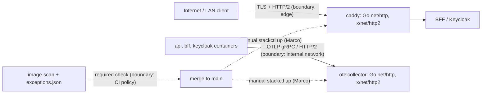

<!-- gate: G3 | verdict: BLOCK | issue: #142 -->
# Threat delta: image-scan exceptions for the 2026-10-08 Go HTTP/2 advisories (#142)

- Date: 2026-10-10. Reviewer: security-reviewer (G3).
- Scope: the planned change only. That means 28 entries in `.github/image-scan/exceptions.json` (`caddy` and `otelcollector`, packages `stdlib` and `golang.org/x/net`, added 2026-10-10, expiring 2026-10-24), plus the go-live notes on #132 and #29. Areas the change does not touch are not re-audited.
- Facts are taken from `docs/ai/pipeline/142.md`. The rules come from ADR-0015 (with its 2026-10-06 amendment), `.github/scripts/image_scan.py` and `.claude/tests/test_image_scan.py`.

## Verdict

**BLOCK.** The plan cannot meet its own Done-when without a policy change that ADR-0015 forbids, and G2 was skipped on the grounds that there is no structural change. See F-1.

## F-1 (fix-now, blocks): the planned exceptions never apply, because D-2 voids them

- **Where.** `image_scan.py`, `evaluate()`:

  ```python
  if hit and fix.get("state") == "fixed":
      if _keeps_fixed_exception(hit, alias, artifact, tag_state):
  ```

  `_keeps_fixed_exception` is true only when `artifact.type` is in `OS_PACKAGE_TYPES` (`apk`, `deb`, `rpm`). For a `go-module` finding with a known fix, an active exception is dropped with the message "exception not applied: a fix is now available, bump the image".
- **The test pins this.** `test_4_a_fixed_go_module_finding_still_blocks_with_an_unchanged_tag` covers exactly `caddy` / `stdlib` with a 14-day exception.
- **The ADR states it.** ADR-0015, amendment item 3, under Scope: every other package type, `go-module` included, "keep[s] the rule that an upstream fix ends the exception immediately". The threat delta for the same amendment calls item 3 "the only allowed narrowing of D-2". Item 2 also describes Go Highs with an upstream fix as ones that D-2 "makes impossible to except".
- **Why it applies here.** All ten advisories are fixed upstream (Go 1.26.9 / 1.27.2, x/net 0.60.0, according to the manifest). Grype therefore reports `fix.state == "fixed"`, and adding the 28 entries leaves `image-scan` red. D-2 assumes a fixed image exists to bump to. Here none does: Caddy 2.11.7 is the newest release, and collector 0.162.0 predates the advisories. That is a real gap in the policy, but closing it is a policy decision, not a data change.
- **Risk if worked around under #142.** The obvious ways to make the check pass are:
  - loosening `_keeps_fixed_exception` or `OS_PACKAGE_TYPES`;
  - adding a per-entry flag (ADR item 3 says "code, not configuration");
  - skipping the step;
  - taking `image-scan` out of the ruleset.

  Each of these weakens a required control without an ADR amendment, without G2 and without the red tests G5 would require. That would be Tampering against the gate itself (High).
- **Ways forward. Marco decides; none is chosen here.**
  1. **Amend ADR-0015.** Add a narrow, time-boxed second exception to D-2 for scan-alias `go-module` findings for which no vendor release with the fix exists yet. Suggested bounds: at most 14 days, Marco's approval recorded in the justification, never for the release images, and red tests covering every bound. This un-skips G2 and G5 and moves #142 to code (`image_scan.py` and its tests). G3 would then re-check against the MUSTs below.
  2. **Wait for upstream.** Caddy and the collector usually ship within days of a Go security release. Bump the digests once each release has cleared the 7-day cooldown, or with a waiver Marco records under ADR-0015 item 2. This needs no exception at all.
  3. **Show that D-2 does not fire.** If the Fix column in the summary of CI run 38037912880 shows `unknown` or `not-fixed` for these rows, rather than a version, F-1 does not apply. Record that evidence in the manifest, and this G3 becomes PASS-WITH-NOTES under the MUSTs below.

## Data flow and trust boundaries



This change adds no new trust boundary. It changes what the CI-policy boundary lets through for 14 days.

## Threats

| Id | Element / flow | STRIDE | Threat | Severity | Mitigation | ASVS 5.0 id | Status |
| --- | --- | --- | --- | --- | --- | --- | --- |
| T-01 | Internet to caddy (HTTP/2) | D | Unauthenticated HTTP/2 DoS of the edge: GO-2026-6612 flow-control refund (Critical), 6603 trailer memory exhaustion, 6611 window-change CPU use. Reachable once deployed, since Caddy terminates HTTP/2 from clients. | High if deployed | Not deployed (#132, #29 not live); expiry 2026-10-24; go-live blocker notes on #132 and #29; bump to a fixed Caddy release | V15.1.1, V15.2.1, V15.2.2 | Accepted only while undeployed (M-3, M-4) |
| T-02 | Internal containers to otelcollector (OTLP over HTTP/2) | D, R | A compromised peer exhausts the collector, and telemetry and audit-relevant logs are lost while it is down | Medium | Internal network only, no published port; reaching it already needs code execution in a peer; not deployed | V15.2.2, V16 | Accepted only while undeployed |
| T-03 | `exceptions.json` | T | Exceptions broader than these 28 findings (another id, package or image, a longer life) silence future findings in the most exposed component | High | M-1, M-2; the validator rejects glob and regex package names, duplicates and expiries over 90 days | V13, V15.2.1 | Mitigated if the MUSTs hold |
| T-04 | `image_scan.py` policy (D-2) | T | The scan is made green by loosening D-2 or the required check instead of by data (F-1) | High | M-5; F-1 ways forward 1 to 3 | V15.1.1 | **Open: BLOCK** |
| T-05 | merge to deployment | E (of risk) | The images run with these findings before 2026-10-24. Nothing in code ties `stackctl up` to the scan, and `docs/runbooks/go-live-gate.md` covers real accounts and data, not a LAN bring-up with synthetic accounts | Medium | Deployment is manual (`stackctl up`, Marco only); `release.yml` builds and pushes the api, bff and migrator images and deploys nothing; notes on #132 and #29 (M-4) | V15.2.1 | Mitigated by process (S-2) |
| T-06 | GO-2026-6604 (`os.Root` junctions) | none | Windows-only; it cannot apply to these linux/amd64 images | Low | None needed beyond honest wording | none | Not applicable |

## MUSTs (for whichever way forward is taken)

- **M-1. Exact entries only.** There is one entry per (id, image, package) that the scan actually reports: 28 entries, `image` either `caddy` or `otelcollector`, `package` exactly `stdlib` or `golang.org/x/net`. The `id` is the CVE or GHSA id Grype reports in `vulnerability.id` or `relatedVulnerabilities`; `GO-2026-*` ids fail `ID_RE`. Put the GO id in the justification text. No entry is added for an advisory or image the scan did not report.
- **M-2. Expiry.** Every entry has `added` 2026-10-10 and `expires` no later than 2026-10-24. No renewal under #142: at expiry, either a fixed digest or a new issue.
- **M-3. Honest justification class.** Each justification states the following:
  - the HTTP/2 code is reachable once the image is deployed;
  - the exception rests only on time and on the stack not being deployed;
  - it is void the moment either image runs anywhere reachable.

  The Caddy entries also carry Marco's recorded approval and date, as the `$comment` rule (#120, S-120-07) requires for a component on the request path of a LAN-reachable service. The GO-2026-6604 entries add "Windows-only".
- **M-4. Go-live block.** Before merge, #132 and #29 each carry a note saying the following. While these entries exist, `caddy` and `otelcollector` are not started on any host: no `stackctl up`, synthetic accounts included. That holds until both digests carry the fixed Go and x/net versions. Marco posts the notes, and G6 checks that they exist.
- **M-5. No policy loosening under these gates.** #142 does not change `image_scan.py`, its tests, `ci.yml`'s `image-scan` job or the ruleset unless an ADR-0015 amendment has been accepted by Marco and G2 and G5 have been un-skipped (F-1, way forward 1).

## SHOULDs

- **S-1 (backlog #83).** Add an item for "open image-scan exceptions on request-path images" to `docs/runbooks/go-live-gate.md`, and have `stackctl check` warn when `exceptions.json` holds an active entry for an image it is about to start. Today T-05 rests on issue text a test cannot see.
- **S-2.** Watch the Caddy and collector releases, and bump once each has cleared the 7-day cooldown (or with a waiver Marco records) before 2026-10-24. The entries are then reported as stale and should be removed.
- **S-3 (informational).** The #120 OpenSSL and zlib exceptions expire on 2026-10-20, four days before these. After that date, `image-scan` goes red again for any PR that touches the image paths, unless Alpine fixes have been bumped. Plan #123's merge window with that in mind.
