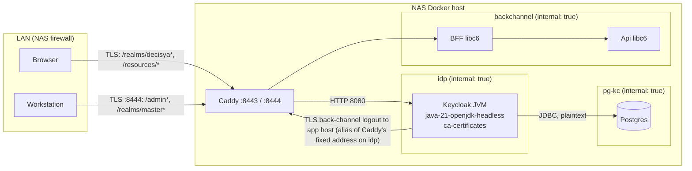

<!-- gate: G3 | verdict: PASS-WITH-NOTES | issue: #190 -->
# Threat delta: except two unfixed Keycloak findings; renew the api/bff libc6 entries (#190)

- Scope: the planned change only. Two new `keycloak` entries and two renewed `api`/`bff` entries in `.github/image-scan/exceptions.json`, plus the pins in `deploy/tests/test_stackctl.py:695-696`. There is no change to `image_scan.py`, ADR-0015, `ContainerImages.cs`, the six `pcre2`/`pcre2-syntax` entries, the `migrator` entry, the Caddy entries or the `$comment`. Areas the change does not touch are not re-audited.
- Sources read for this ruling: manifest `docs/ai/pipeline/190.md`; `exceptions.json`; `image_scan.py` `exception_errors` and `vendor_binary_approval`; `test_stackctl.py:691-701`; `deploy/compose/docker-compose.stack.yaml` (Keycloak service, networks); `deploy/compose/docker-compose.yaml:40-58` (Keycloak environment); `deploy/compose/stackguards.py:88-95, 171, 651-653`; `deploy/caddy/Caddyfile`; `deploy/keycloak/entrypoint-stack.sh`; `deploy/keycloak/production/realm-decisya.json:1-264`; `deploy/keycloak/decisya-realm.json` (searched); `src/Decisya.AppHost/AppHost.cs:122-131`; `docs/security/threat-models/deployable-stack.md` (S-120-07, T120-12); `docs/security/threat-models/image-scan-renew-120.md` (#143 M-2, T-02).
- The Red Hat advisory text in the manifest's hand-off is used as data. Its CVSS metrics are preliminary.

## Verdict

**PASS-WITH-NOTES.** Both Keycloak exceptions are acceptable for the deployed context, for 9 days, on the reachability arguments below. The arguments do not rest on "not loaded". The libc6 renewal is acceptable as a fresh 30-day acceptance under #190. Merge depends on M-1 to M-5. No High or Medium flaw was found in unchanged code.

Scope point (9) does not apply today: there is no fixed Keycloak image. `26.7.5` is still at `sha256:37dbaf6f0722…`, there is no `26.7.6`, and the `26.8.1` cooldown runs to 2026-10-30, after the 2026-10-28 merge date. So point (10) does not arise, and the bump does not go first. M-5 makes G4 re-check this at commit time.

## Data flow

Trust boundaries: LAN to Caddy (TLS, firewall), Caddy to Keycloak (HTTP on `idp`), Keycloak to Caddy (Keycloak as a TLS client, the only outbound TLS it makes), Keycloak to Postgres (`pg-kc`). Keycloak has no network with egress. Both of its networks are `internal: true` (`docker-compose.stack.yaml:101-103, 303-314`), and the guard pins both the membership and the flag (`stackguards.py:90, 651-653`).

## Rulings

### CVE-2026-91415, `java-21-openjdk-headless` (OpenJDK 2D, font rendering): accepted to 2026-11-02

- **Loaded: yes.** This package is the JVM that serves every Keycloak request. The argument rests on **input**: the flaw is reached only when attacker-controlled font, text-layout or image data goes to the Java 2D APIs. The advisory's vector (`AV:N/AC:H/PR:N`) assumes "a service that processes graphics data".
- **Paths reachable from the network** (Caddyfile): from the LAN, on 8443, `/realms/decisya*` and `/resources/*`. From the workstation only, on 8444, `/admin*`, `/realms/master*` and `/resources/*`. Port 9000 is never routed.
- **Where Keycloak touches 2D, and what goes in:**
  - **OTP QR code** (`CONFIGURE_TOTP`, required for platform-admin by `level-2-admin`). Keycloak encodes a server-built `otpauth://` URI (the generated secret, the realm name, the username) into a bit matrix and writes it out as a PNG. This draws no font, renders no text and decodes no image. The username is not user-controlled: `registrationAllowed: false`, `editUsernameAllowed: false`, and accounts are made by the admin.
  - **`/resources/*`.** Theme fonts and images go to the browser as bytes. The JVM does not render them.
  - **No upload that parses graphics** on the LAN paths. The realm has no identity providers and no SMTP server (`realm-decisya.json`). Only the built-in themes ship: the stack's bind-mount table (`stackguards.py:171`, enforced at `check` and `verify`) admits only the wrapper, the realm file and the password list, so no provider or theme JAR can be added.
  - **The admin console** is the only place an image upload could exist, through a preview UI-customisation feature. It is on 8444, workstation-only, behind admin authentication with OTP. That is not the advisory's unauthenticated attacker, and the stack sets no `KC_FEATURES`.
- **Residual:** an unknown 2D path. The worst case is that Keycloak stops (login unavailable) or does a limited read or write. The stack is not deployed (#132, #29), the window is 9 days, and the Caddy item-4 entries make `stackctl up` refuse until the Caddy bump. **Low in context.**

### CVE-2026-114406, `ca-certificates` (eMudhra-signed weak-key intermediates): accepted to 2026-11-02

- **The trust store is in use.** Java's `cacerts` on UBI9 is derived from the system store. `KC_TRUSTSTORE_PATHS` (`docker-compose.yaml:58`) **adds** the Caddy root to the default truststore; it does not replace it. Treat the affected roots as trusted by Keycloak as a TLS client. This store does not affect browsers, which use their own.
- **Keycloak's outbound TLS peers:**
  - **Back-channel logout** to `https://<app host>:8443/bff/backchannel-logout` (`realm-decisya.json:181`). The app host is a network alias of Caddy's fixed address on `idp` (`docker-compose.stack.yaml:168-171`).
  - **Postgres** over JDBC, plaintext on `pg-kc` (`KC_DB_URL`, no TLS, so no CA store is involved).
  - **Nothing else.** The realm has no identity provider, no SMTP server, no client JWKS URL (the BFF uses `client-secret`), and no `request.uris` or sector identifier URI. An admin who later adds an outbound peer gets no route out, because there is no egress network.
- **Does the internal-only network remove the MITM path? Yes, for anyone who is not already in.** To intercept Keycloak's one TLS peer, an attacker needs a position on the `idp` bridge, which holds only Caddy and Keycloak, both with `cap_drop: [ALL]` (no `NET_RAW`), or root on the Docker host. Either position is already a full compromise of the identity tier, and a weak-key certificate adds nothing to it. The vector also needs `UI:R` and a recovered weak key (`AC:H`).
- **Residual: Low in context.**

### libc6 CVE-2016-20013 (`api`, `bff`): renewed as a fresh 30-day acceptance

- **Ruling on the open question: the window counts from the new approval.** #143 kept `added` so that a 30-day bound could not be **silently** restarted (T-02 there), and it allowed a later renewal through "a new issue and a fresh G3". This issue is that new issue and this G3 is that fresh decision.
- **Why `added` cannot stay at 2026-10-05.** Any expiry past 2026-11-04 would then show more than 30 days between `added` and `expires`. S-120-07's "at most 30 days" would no longer be readable from the entry's own fields, and the check that S-1 below adds would fail.
- **What limits chaining.** The first acceptance stays visible in the justification text. Each further renewal needs a new issue, a fresh G3, Marco's dated approval, a re-check and a visible edit of the test pin.
- **The finding class fits a rolling window.** Ubuntu rates it `wont-fix`/negligible, and the vulnerable function (`crypt()` SHA-crypt) is not called by the .NET apps.

## Threats

| Id | Element / flow | STRIDE | Threat | Severity | Mitigation | ASVS 5.0 id | Status |
| --- | --- | --- | --- | --- | --- | --- | --- |
| T190-01 | LAN → Caddy → Keycloak JVM (2D) | D, I, T | Crafted font or graphics input reaches OpenJDK 2D (CVE-2026-91415) | Low in context | No attacker input to 2D on reachable paths; admin on 8444 + OTP; mount table; 9-day expiry; M-1 | V15.2.1, V15.1.1 | Accepted to 2026-11-02 |
| T190-02 | Keycloak → Caddy (Keycloak as TLS client) | S, T | A weak-key certificate chaining to a root in the system store lets someone MITM Keycloak's outbound TLS (CVE-2026-114406) | Low in context | No egress; only peer is Caddy on internal `idp`; `NET_RAW` dropped; guard pins networks; M-2 | V12.3, V15.2.1 | Accepted to 2026-11-02 |
| T190-03 | `exceptions.json` `added` on libc6 | T, E | 30-day renewals chained without a visible decision (#143 T-02) | Low | New `added`/`issue` only under a new issue + G3 + approval; first acceptance kept in the text; M-3, M-4, S-1 | V15.2.1 | Mitigated if M-3, M-4 hold |
| T190-04 | Justification premises | T | A later change (an egress network, an IdP, SMTP, `KC_FEATURES`, a provider mount) makes a Keycloak justification false while the entry is live (T120-12) | Low | Premises named in each justification (M-1, M-2); 9-day expiry; guard pins networks and mounts | V15.2.1, V13.2 | Mitigated if M-1, M-2 hold |
| T190-05 | Approval record | R | An approval or a date is written before Marco gives it, or the PR body does not carry it (S-120-07) | Medium (process) | M-5 | V15.1.1 | Open, fix-now |

## MUSTs for G4 (all fix-now)

- **M-1. Keycloak CVE-2026-91415 entry.**
  - Fields:
    - `id` `CVE-2026-91415`
    - `image` `keycloak`
    - `package` `java-21-openjdk-headless`
    - `issue` `#190`
    - `added` = the commit date (2026-10-24 if committed today; never before Marco's approval date)
    - `expires` `2026-11-02`
  - The justification must contain, in this order:
    - (a) the finding: version `1:21.0.12.1.1-1.2.el9`, fix state not-fixed, OpenJDK 2D font rendering, CWE-787, Grype High, Red Hat CVSS 3.1 4.8 (preliminary) `AV:N/AC:H/PR:N/UI:N/S:U/C:L/I:L/A:N` and cve.org 7.0 with High availability (both scores, not only the lower one);
    - (b) a plain statement that the package is the JVM serving Keycloak's HTTP and is loaded;
    - (c) the deployed context: Keycloak on the internal `idp` and `pg-kc` networks only; Caddy admits the LAN to `/realms/decisya*` and `/resources/*` on 8443 and the workstation to the admin paths on 8444; port 9000 is never routed; the stack is not yet deployed (#132, #29);
    - (d) the reachability argument from the ruling above: the QR code takes server-built input and renders no text or font; `/resources/*` is served as bytes; there is no upload that parses graphics on the LAN paths; there is no IdP or SMTP; the mount table admits no provider or theme; `KC_FEATURES` is not set; the admin console is workstation-only and needs authentication with OTP;
    - (e) the premises that void the entry: any change to Keycloak's networks, mounts, `KC_FEATURES`, the realm's identity providers or SMTP;
    - (f) "issue #190", exactly one `approved by Marco YYYY-MM-DD`, with the date no later than `added`;
    - (g) "Not renewed past this expiry without a new issue and a fresh G3".
  - The justification must not contain "dev-only" or "not loaded".
  - Before writing (d), G4 confirms each point from the file named and records the file and line in the manifest's G4 evidence:
    - the Keycloak bind mounts match `stackguards.py:171-175`;
    - there is no `KC_FEATURES` in `docker-compose.yaml` (Keycloak service);
    - `realm-decisya.json` has no `identityProviders`, no `smtpServer`, `registrationAllowed: false` and `editUsernameAllowed: false`;
    - the user-profile component has no file or image attribute;
    - the Caddyfile id-host routes are as stated.
  - If any point fails, stop and report. Do not write the entry.
- **M-2. Keycloak CVE-2026-114406 entry.**
  - Fields:
    - `id` `CVE-2026-114406`
    - `image` `keycloak`
    - `package` `ca-certificates`
    - `issue` `#190`
    - `added` = the commit date
    - `expires` `2026-11-02`
  - The justification must contain:
    - (a) the finding: version `2025.2.80_v9.0.305-91.el9`, fix state not-fixed, roots that signed eMudhra intermediates with weak keys, Grype Critical, Red Hat CVSS 3.1 6.8 `AV:N/AC:H/PR:N/UI:R/S:U/C:H/I:H/A:N`;
    - (b) a plain statement that Java's `cacerts` derives from this store and that Keycloak trusts it as a TLS client;
    - (c) the deployed context, as in M-1 (c);
    - (d) the reachability argument: Keycloak's only outbound TLS peer is the back-channel logout to the app host, which resolves to Caddy on the internal `idp` network; JDBC to Postgres is plaintext on internal `pg-kc`; the realm has no IdP, SMTP or JWKS URL; there is no egress network; a MITM needs a position on `idp` (Caddy and Keycloak only, `NET_RAW` dropped) or root on the host, which is already a compromise; browsers do not use this store;
    - (e) the voiding premises: any egress network, or any outbound peer outside `idp`/`pg-kc`;
    - (f), (g) and the bans, as in M-1.
  - G4 confirms these and records them in the G4 evidence:
    - Keycloak's networks and their `internal` flags (`docker-compose.stack.yaml:101-103, 303-314`; `stackguards.py:90, 651-653`);
    - the Caddy alias for the app host on `idp` (`docker-compose.stack.yaml:168-171`);
    - `backchannel.logout.url` (`realm-decisya.json:181`);
    - `KC_DB_URL` and `KC_TRUSTSTORE_PATHS` (`docker-compose.yaml:47, 58`).
- **M-3. Renewed libc6 entries (`api` and `bff`, CVE-2016-20013).** Edit both in place.
  - Fields:
    - `issue` `#190`
    - `added` = the commit date
    - `expires` `2026-11-23` (30 days from 2026-10-24; fewer if the commit is later; never later than `added` + 30)
    - `id`, `image` and `package` stay byte-identical.
  - The justification keeps the existing technical sentence (Ubuntu negligible and `wont-fix`; `crypt()` SHA-crypt is never called by the .NET apps) and adds:
    - "first accepted 2026-10-05 under #120 (S-120-07)";
    - "renewed under #190: re-checked `<date>`, Ubuntu fix state still wont-fix (source: `<the Ubuntu CVE tracker page or the scan row>`), aspnet base `sha256:<12 hex>…` in `.github/release/base-images.Dockerfile`";
    - the request-path sentence for the Api or the BFF;
    - exactly one `approved by Marco YYYY-MM-DD`;
    - "a further renewal needs a new issue and a fresh G3".
  - Remove the old "Marco approved this exception on 2026-10-05" wording, so that the entry carries only one approval phrase.
  - Before writing, G4 confirms that the digest is still `sha256:3ed6558056b5…` and that the scan on this branch still reports the finding as `wont-fix`. If the fix state changed, stop and report.
- **M-4. `test_stackctl.py`.**
  - Lines 695-696 assert `2026-11-23` for `api` and `bff`.
  - Line 697 (`migrator` `2026-12-31`) and lines 698-701 stay unchanged.
  - The two new Keycloak entries must pass the 2026-11-02 cap and the "dev-only" ban as they stand.
  - Run the full `deploy/tests`, `.claude` and .NET unit suites before pushing, per the working agreements.
- **M-5. Approval, re-checks, and no other change.**
  - Marco gives his approval of the four entries (dates and justification text) after this G3 and before the commit. G4 writes no approval date that he has not given.
  - The PR body records Marco's approval and date for each of the four entries (S-120-07). It also states that the libc6 `added` and `issue` were reset on purpose, as a fresh 30-day acceptance under this G3, which departs from #143 M-2's keep-`added` form for the first window.
  - At commit time, G4 re-checks quay.io and records the result in the G4 evidence:
    - `26.7.5` is still at `sha256:37dbaf6f0722…`;
    - there is no `26.7.6`;
    - `26.8.1` is still in cooldown.
  - If a fixed image has cleared cooldown, stop and report to Marco (scope point 9). Do not write the Keycloak entries.
  - `git diff origin/main...HEAD` touches only `exceptions.json`, `test_stackctl.py` and the gate documents. Every other entry and the `$comment` stay byte-identical.

## SHOULDs

- **S-1 (fix-now, Low, `test_stackctl.py`, a few lines in the changed test).** In `test_the_libc6_exceptions_on_the_request_path_expire_in_30_days`, assert `expires - added <= 30 days` for every entry whose `image` is `api`, `bff`, `caddy` or `keycloak`. This puts S-120-07's bound into code, which the validator does not do for these entries. All current and planned entries pass: the Caddy item-4 entries are 14 days, `curl` and `pcre2` are 30, the new Keycloak entries are 9, and libc6 is at most 30.
- **S-2 (backlog #83).** `docs/runbooks/ci-security-gates.md`, "Add or renew an exception": refine #143 S-1. Within the first 30-day window, keep `added` and `issue`. A renewal past that window is a new acceptance: new issue, fresh G3, new `added` and `issue`, and the first acceptance recorded in the text.

## Notes for Marco (do not change the merge decision)

- **N-1. The 2026-11-02 cliff.** The two Keycloak findings are not fixed upstream, so `26.8.1` (rebuilt 2026-10-23) may still carry them. The Keycloak 26.8.1 bump issue due by 2026-11-02 should re-scan and plan for this. A Keycloak entry past 2026-11-02 needs a new issue, a fresh G3 and a change to the `test_stackctl.py:698-700` cap, which is outside #190.
- **N-2. The libc6 renewal and the next base bump.** The renewed libc6 entries expire 2026-11-23. The next aspnet base bump (the .NET November patch) re-runs the scan. Because matching is exact on (image, package, id), the entries will keep matching across that bump, so the base-bump PR should re-confirm the `wont-fix` state.
