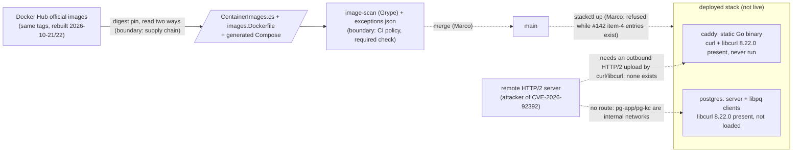

<!-- gate: G3 | verdict: PASS-WITH-NOTES | issue: #183 -->
# Threat delta: postgres, redis and caddy rebuilds for zlib CVE-2026-85091; caddy curl CVE-2026-92392 (#183)

- Date: 2026-10-22. Reviewer: security-reviewer (G3, Full tier).
- Scope: only the planned change. Three digest bumps (`ContainerImages.cs`, `images.Dockerfile`, the regenerated `deploy/compose/docker-compose.yaml`) and the `exceptions.json` edits from G2 D2 and D3. I did not re-audit areas the change does not touch.
- Inputs, all read as data:
  - G2 `docs/architecture/image-zlib-curl.md`;
  - the orchestrator's CVE-2026-92392 evidence (curl advisory JSON, GHSA, NVD, `apk info -v` of the three new digests, CI run 39759712940);
  - `.github/scripts/image_scan.py` (`evaluate`, `_keeps_fixed_exception`, `is_vendor_binary_entry`);
  - ADR-0015 with its 2026-10-06 and 2026-10-17 amendments;
  - `exceptions.json`;
  - `deploy/compose/docker-compose.yaml` and `docker-compose.stack.yaml`;
  - `deploy/compose/stackctl.py`, `deploy/tests/stack_smoke.py`, `deploy/tests/test_keyring.py`;
  - `deploy/postgres/init/*.sh`;
  - `src/Decisya.AppHost/AppHost.cs` and `ContainerImages.cs`;
  - the #143 and #142 threat deltas, used as precedent.
- I found no High or Medium in unchanged code to escalate.

## Verdict

**PASS-WITH-NOTES.** The pin bumps and the zlib removals are sound. G2's class (a) route for the caddy `curl` finding holds, even though libcurl is affected too: in the caddy image, nothing executes the curl tool or loads libcurl. The postgres libcurl is not reached, and the scan does not report it, so it needs no exception. G4 may start under M-1 to M-4. The cooldown waiver is Marco's decision, and either choice passes this gate.

## Data flow and trust boundaries

The change adds no new trust boundary. It moves three pins across the supply-chain boundary and changes what the CI-policy boundary lets through: three entries out, one entry in.

## Decisions on the caller's questions

### 1. CVE-2026-92392 in caddy: is class (a) sound now that libcurl is affected?

**Yes.** The exception covers the `curl` apk finding, which is the only row Grype reports. The flaw is in libcurl code that both the tool and the library carry. It fires only in a process that performs an HTTP/2 upload with libcurl, and only when the remote server answers with `RST_STREAM` (`HTTP_1_1_REQUIRED` or `REFUSED_STREAM`). In our use of the caddy image, no process does that:

- **Caddy itself.** Caddy is a static Go binary (`CGO_ENABLED=0`). It links no shared library, so it cannot load `libcurl.so`. Its outbound traffic (reverse proxy, ACME) goes through Go's own `net/http`.
- **Other binaries.** In an Alpine image, the only package that depends on `libcurl` is `curl`. G4 confirms this from the image (M-2). Nothing we run in this image calls `curl`:
  - the generated Compose healthcheck is `nc -z` (busybox);
  - the overlay sets no entrypoint, command or healthcheck, and the container runs with `cap_drop: [ALL]` and `read_only`;
  - `stackctl.py` runs `caddy adapt` with `--network none`;
  - the key-ring one-shots run with `--network none --entrypoint sh`, and `test_keyring.py` bans `curl` and `wget` in their scripts;
  - `stack_smoke.py` runs `--entrypoint wget` (busybox) in this image. Its `curl_status` and `curl_probe` calls use the host's curl, not the image's.
- **Shell route.** The stock Caddy build has no exec handler, and the Caddyfile only reverse-proxies. Nothing in the image gives the network a shell.
- **Second precondition.** Even if curl ran, the attacker must be the remote server of an HTTP/2 upload that this container starts. No part of our use makes such an upload.

The caddy `libcurl` package rests on the same argument. Grype does not report it, so it gets no entry (M-3). The justification still names it, so the record matches the advisory's "affects both".

Context severity: **Low** (base High, `AV:N/AC:H`). The exception's required content is in M-1.

### 2. postgres libcurl 8.22.0-r0

**In scope of the advisory, not reached in our stack.**

- **Why the image carries libcurl.** PostgreSQL 18 uses it for the client side of the libpq OAuth device flow, in a separately loaded module. libpq loads that module only when a connection asks for OAuth (`oauth_issuer` / `oauth_client_id`). The server process does not link libcurl. Server-side OAuth uses validator modules, and we configure none.
- **What our stack runs in that image:**
  - the server;
  - the `pg_isready -U postgres -d postgres` healthcheck;
  - `10-keycloak-db.sh` and `20-decisya-db.sh`, which run `psql --username "$POSTGRES_USER" --dbname postgres` over the local socket;
  - `stackctl.py`'s `exec -T postgres psql -U postgres ...`.

  None of these passes an OAuth parameter. A repository-wide search for `oauth_issuer`, `oauth_client_id`, `oauth_validator`, `libpq-oauth` and `PGOAUTH` finds nothing.
- **Clients in other images.** Keycloak uses JDBC, and the migrator and Api use Npgsql. Neither loads libpq.
- **Network.** Even if libcurl were loaded, postgres sits only on `pg-app` and `pg-kc`, which are `internal: true`. No route leads to a remote HTTP/2 server.
- **Grype's miss.** Grype flagged `curl` but not `libcurl` in either image. Both are subpackages of the same Alpine `curl` origin, so this looks like a name-keyed match before Alpine has a secdb entry. That is a scanner coverage gap.
- **Merge decision.** The miss does not change it. The scan does not fail, and an exception for a finding the scan does not report would be wrong (#142 M-1 precedent: "No entry is added for an advisory or image the scan did not report").
- **What the PR records.** A one-line not-reached note in the manifest's G4 evidence (S-1, fix-now). The expected follow-up goes to #83 (S-2, backlog).

Context severity: **Low**.

### 3. Cooldown waiver: a blocking risk?

**No.**

- **When the cooldown ends.** The 7-day cooldown ends for caddy on 2026-10-28 at 23:52 UTC, for redis on 2026-10-29 at 00:07 UTC and for postgres on 2026-10-29 at 01:11 UTC.
- **The deadline.** The #142 item-4 entries are active through 2026-10-31. So a merge without a waiver is possible from 2026-10-29 at 01:11 UTC through 2026-10-31.
- **What a waiver would accept.** A malicious or broken same-tag rebuild that the community had not yet noticed. That risk is bounded:
  - the pin is an index digest read two ways;
  - the scan runs on exactly that digest;
  - the images run only on Marco's host and in CI with synthetic data;
  - the stack is not deployed, and `stackctl up` refuses Caddy while the #142 entries exist.
- **Recommendation.** Waiting costs nothing and leaves a margin of about 2.9 days, so I recommend waiting (S-4). A waiver is acceptable if Marco records it himself (M-4). ADR-0015 amendment item 3 allows that, as #120 and #142 did.

### 4. OpenSSL justifications that name the old digest

**SHOULD, not MUST** (S-3).

- Code never reads the justification text. Item 3 checks the tag state again on every run.
- The entries expire on 2026-11-02.
- Editing the text would be a renewal (#143 M-2), which is a larger change than the inaccuracy it fixes.
- The surviving entries therefore stay byte-identical. The manifest records that their digest and version references are pre-#183 history and that #183 did not re-accept them.

## Threats

| Id | Element / flow | STRIDE | Threat | Severity | Mitigation | ASVS 5.0 id | Status |
| --- | --- | --- | --- | --- | --- | --- | --- |
| T-01 | caddy image: curl/libcurl 8.22.0 (CVE-2026-92392) | T, I, D, E | Use-after-free in libcurl triggered by a malicious remote server during an outbound HTTP/2 upload | High base; Low in context | Class (a): Caddy is static Go; libcurl's only consumer is `curl`, which nothing runs; no upload exists; the entry spans 30 days or less and ends when the tag moves (M-1, M-2) | V15.1.1, V15.2.1 | Mitigated if M-1 and M-2 hold |
| T-02 | postgres image: libcurl 8.22.0 | T, I, D, E | Same flaw, through the libpq OAuth client module | Low | Not loaded: no OAuth connection anywhere, the server does not link libcurl, internal-only networks; not reported, so no entry (S-1, S-2) | V15.2.1 | Accepted, not reached |
| T-03 | `exceptions.json` | T | The edit reaches further than planned: OpenSSL entries renewed or edited, #142 item-4 entries touched, `libcurl` entries added pre-emptively, an expiry extended | Medium | M-3; exact-match validator | V15.1.1, V15.2.1 | Mitigated if M-3 holds |
| T-04 | Pin source to Compose and scan | T | Wrong or single-arch digest, Compose drift, or a younger-than-cooldown rebuild merged without a recorded waiver | Medium | M-4; `ContainerImageParityTests`; CI drift check | V15.2.1, V13 | Mitigated if M-4 holds |
| T-05 | Caddy entry approval | R | An approval phrase Marco did not give, or a date that does not match his, on a request-path component (S-120-07 rule; code does not enforce it for non-item-4 entries) | Medium | M-1, M-2; S-5 test | V15.1.1 | Mitigated if M-1 and M-2 hold |
| T-06 | Required `image-scan` check before 2026-10-31 | T | The #142 deadline pushes someone to weaken the gate (skip the step, change `image_scan.py`, change the ruleset) instead of landing the data change | Medium if done | M-3 (no policy change), M-4 (timing) | V15.1.1 | Mitigated if the MUSTs hold |
| T-07 | Surviving OpenSSL justifications | R | The text names pre-#183 digests and OpenSSL 3.5.8 and reads as current | Low | S-3 | V15.1.1 | Note |

## MUSTs (fix-now; G4 implements them, G6 checks them)

- **M-1 (T-01, T-05). The caddy curl entry.**
  - **Key.** Exactly one entry: `id` is the id Grype reports in `vulnerability.id` (expected `CVE-2026-92392`), `image` `caddy`, `package` `curl`, `issue` `#183`.
  - **Dates.** `added` is the commit date and is not before Marco's approval date. `expires` is at most 30 days after `added`, and no later than 2026-11-21.
    - Because of the 30-day span, item 3 keeps the entry while the tag is unchanged if Alpine ships curl 8.23.0 first.
    - A rebuilt tag ends the entry at once. That is intended: bump then.
  - **Justification.** Plain ASCII, at least 20 characters, and it states:
    - the fix state at scan time (unknown), that the advisory affects both the curl tool and libcurl, and that the fix is curl 8.23.0;
    - the reachability class: (a) not loaded, not executed. Caddy is a static Go binary (`CGO_ENABLED=0`) and loads no libcurl. The only consumer of libcurl in the image is `curl`. Nothing runs `curl`: the `nc -z` healthcheck, no entrypoint in the overlay, the `--network none` sh one-shots (curl banned by test), busybox `wget` in the smoke test, `caddy adapt`;
    - that the flaw needs an outbound HTTP/2 upload to a malicious server, which no process in the image makes;
    - that `libcurl` in this image rests on the same argument and is not reported separately;
    - "ends when Alpine ships curl 8.23.0 and the caddy tag is rebuilt; bump the digest then; not renewed";
    - exactly one `approved by Marco YYYY-MM-DD`, with the date Marco himself gave.
- **M-2 (T-01, T-05). Evidence and approval in the manifest.**
  - **Grype match.** G4 records, under G4 evidence, the Grype match for the caddy `curl` row: `artifact.type` `apk`, name, version `8.22.0-r0`, location, fix state, `vulnerability.id`.
  - **Reverse dependencies.** G4 records the reverse-dependency listing of `libcurl` in the new caddy digest (`apk info -r libcurl`, run in a `--network none` one-shot like the existing `apk info -v` evidence). It shows `curl` as the only dependent. If any other package depends on libcurl, stop and report: class (a) then needs that binary's call sites checked.
  - **Approval.** Marco's approval is written in the manifest by Marco, or quoted from his own message with its date. An orchestrator or agent message is not that approval. G6 checks that the date in the entry matches.
- **M-3 (T-03, T-06). Exceptions: exactly the planned set, no policy change.**
  - **Removed.** The three `CVE-2026-85091` `zlib` entries (postgres and redis, issue `#83`; caddy, issue `#120`), plus exactly the OpenSSL entries that the PR's own scan lists as `stale (matched nothing)`, image by image.
  - **Kept byte-identical.** Every other entry, including still-matching OpenSSL entries (no new `expires`, `added` or justification), the 16 #142 item-4 entries, keycloak `pcre2` and the release-image `libc6` entries, and the `$comment`.
  - **Not added.** No `libcurl` entry for caddy or postgres, and no entry for any finding the scan does not report.
  - **Stop condition.** If the scan lists any #142 entry as stale, stop and report (G2 D2).
  - **Untouched.** `image_scan.py`, its tests, `ci.yml`'s `image-scan` job and the ruleset. The only test change is the optional G5 fact in S-5.
- **M-4 (T-04, T-06). Pins, timing and the green run.**
  - **Digests.** The three digests are exactly G2 D1's multi-arch index digests, each read two ways and recorded with its push date. `images.Dockerfile` matches `ContainerImages.cs`. The regenerated Compose diff is exactly the three `image:` lines and comes from the publish, never a hand edit. The stale comments in `ContainerImages.cs` are replaced: Postgres "not re-resolved here", and the Caddy waiver text that describes the old digest.
  - **Merge timing.**
    - Without a waiver, the merge waits until 2026-10-29 at 01:11 UTC.
    - With a waiver, Marco records a one-off waiver, dated, in the manifest and in the `ContainerImages.cs` comment, worded as no precedent (as #120 and #142 did).
  - **Green run.** The PR's green `image-scan` run happens on or before 2026-10-31. Its log shows:
    - the three new digests with `tag state unchanged`;
    - no `CVE-2026-85091` row;
    - the caddy `curl` row as `excepted`;
    - no `FAIL`.

    The orchestrator records the run id.

## SHOULDs

- **S-1 (fix-now, Low; manifest).** One line under G4 evidence: "postgres libcurl 8.22.0-r0 (CVE-2026-92392, affects libcurl): not reported by Grype; not reached: the server does not link libcurl, libpq loads its OAuth module only for OAuth connections and none exist in the repo, and postgres is on internal networks only; no exception (nothing to except)." If it is cheap, G4 adds the dynamic-dependency listing of the `postgres` binary from a `--network none` one-shot, showing no libcurl.
- **S-2 (backlog #83, Low).**
  - **Expected follow-up.** Once Alpine publishes curl 8.23.0-r0, Grype will probably start reporting `libcurl` in caddy and postgres as `fixed`. The Docker official images will then rebuild under the same tags. The expected response is a digest bump, not new entries.
  - **Scanner gap.** Record the coverage gap too: before a secdb entry exists, the apk subpackage `libcurl` was not matched. When another advisory says "affects libcurl", the reviewer checks the `libcurl` subpackage by hand.
- **S-3 (fix-now, Low; manifest or PR body).** One line: the OpenSSL entries kept by #183 still name the pre-#183 digests and OpenSSL 3.5.8. That text is historical, the entries were not re-accepted under #183, and they expire on 2026-11-02.
- **S-4 (process).** Prefer waiting out the cooldown (2026-10-29 01:11 UTC) over a waiver. That leaves a margin of about 2.9 days before 2026-10-31.
- **S-5 (fix-now, Low; G5).** G2 D4's live-file fact in `ContainerImageParityTests`:
  - no `CVE-2026-85091` `zlib` entry for postgres, redis or caddy;
  - the caddy `curl` entry names `#183`, contains exactly one `approved by Marco <date>` and spans 30 days or less.

  Today nothing in code enforces the approval rule for a non-item-4 Caddy entry.
