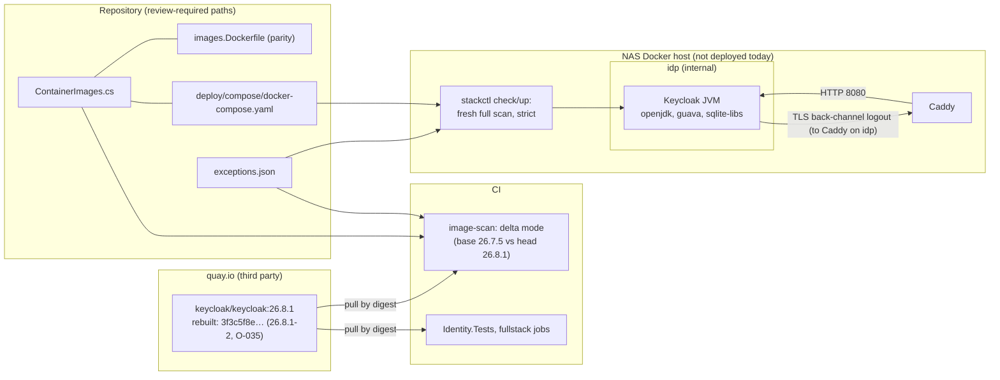

<!-- gate: G3 | verdict: PASS-WITH-NOTES | issue: #268 -->
# Threat delta: bump Keycloak to 26.8.1, the rebuilt digest (#268)

- Written 2026-11-03; **updated 2026-11-08** after the work resumed (manifest, "Resumed 2026-11-08"). The update adds E-4 and E-5, re-dates E-1 to E-5 to 2026-11-08, sets E-1's fix state to `wont-fix`, moves the Ostium references from O-031 (closed) to O-035, marks M-1 met and moves the M-3 cap to 2026-12-08.
- **Re-checked 2026-11-08** (M-5 requires a G3 re-check for any fix inside #268; done together with the single G6 re-check). The fix for G6 S-268-01 (Marco 2026-11-08, "approve the fix") adds one server option, `KC_FEATURES_DISABLED` = `scim-api`, to the stack's Keycloak (`ComposeStack.cs` and `deploy/compose/docker-compose.yaml`), the production test fixture (`ProductionKeycloakStack.cs`) and the dev Keycloak (`AppHost.cs`, parity). It adds `ProductionFeatureTests.The_scim_api_feature_is_disabled` and a `ComposeStackPublishTests` assertion. It also adds `KC_FEATURES_DISABLED` to the `AllowedLiteralEnvironmentKeys` of `AppHostConfigurationTests`, with the value pinned to `"scim-api"` (Marco 2026-11-08, option A). T268-07 and M-5 are updated in place.
- Scope: the planned change only. The Keycloak pin moves from `26.7.5@sha256:37dbaf6f0722…` to `26.8.1@sha256:3f3c5f8e03c614774b4bd9173b88391fefa4153bfc010d8012d59ad825377332` (build `26.8.1-2`, amd64 `de6ed510…`; Marco 2026-11-03, option A; baselined by Ostium in O-035, 2026-11-07). The `keycloak` entries in `.github/image-scan/exceptions.json` are replaced, and the keycloak expiry cap in `deploy/tests/test_stackctl.py` is changed. No change to `image_scan.py`, ADR-0015, ADR-0022, the realm files, the wrapper or the Compose overlay. The S-268-01 fix (re-check above) adds one Keycloak server option to the stack, the production fixture and the dev AppHost, and one allow-listed key to the AppHost secrets guard. Areas the change does not touch are not re-audited.
- Sources read: manifest `docs/ai/pipeline/268.md` (with the "Resumed 2026-11-08" block and the amended Done-when); ADR-0014 item 4; ADR-0015 with its amendments; ADR-0022; `exceptions.json`; `image_scan.py` (`exception_errors` and its constants, `evaluate`, `_keeps_fixed_exception`, `select_mode` and `IMAGES_LANE_RE`, `compare_alias`, `new_findings`); `.github/image-scan/Dockerfile` (Grype v0.120.0); `src/Decisya.AppHost/ContainerImages.cs`; `.devcontainer/engine/images.Dockerfile`; `deploy/compose/docker-compose.yaml` (Keycloak service); `deploy/compose/docker-compose.stack.yaml` (Keycloak networks, `cap_drop`); `deploy/keycloak/entrypoint-stack.sh`; `deploy/keycloak/production/realm-decisya.json` (searched); `deploy/tests/test_stackctl.py:696-711`; `.claude/tests` and `deploy/tests` (searched for keycloak caps and the finding ids); `tests/Decisya.Identity.Tests/Production/ProductionKeycloakStack.cs`; `ci.yml:76-99` (lanes); the `keycloak` skill; D-008 as Decisya records it (`docs/PHASE-0.md` waiver, `docs/security/asvs-l2.md:71-74`); the earlier rulings `image-scan-keycloak-libc6-190.md` (N-1) and `image-scan-drift-195.md`.
- The scan figures are the orchestrator's, used as data. 2026-11-03: Grype v0.120.0, amd64, one database built 2026-11-03 06:20 for three runs. **2026-11-08 (current):** Grype v0.120.0 (CI's pin), amd64, database built 2026-11-08T06:19:57Z, one run each on the rebuild `3f3c5f8e…` and Ostium's earlier digest `a78d6b79…`.

## Verdict

**PASS-WITH-NOTES.** The rebuild is the right pin: it clears the request-path High that makes this bump due (jackson-databind CVE-2026-91777 and its GHSA), the openjdk High CVE-2026-91415, the ca-certificates Critical CVE-2026-114406 and the six `pcre2` entries. On the 2026-11-08 database it leaves **1 Critical and 5 High**, the same count Ostium's O-035 reports with Grype v0.121.0 and the 2026-11-07 database. Five of those six can take a 30-day S-120-07 exception on the reachability arguments below: E-1 (openjdk, `wont-fix`), and E-2 to E-5 (sqlite-libs, `not-fixed`, each only after the M-2 evidence). The two new sqlite-libs Highs (CVE-2026-119374 and CVE-2026-119379) are new database entries, not changes from the rebuild (O-035), and they take the same argument as E-2 and E-3. Guava has no exception route. It does not block this PR, but it keeps the deploy gate shut; Marco's amended Done-when (2026-11-08) now says so, so the G7 part of M-5 is done. Merge depends on M-2 to M-5. No High or Medium flaw was found in unchanged code.

**M-1 is met without a waiver.** The 2026-11-03 text said the rebuild was pushed after Ostium's scan; the quay.io tag history recorded in the manifest that day shows otherwise: `26.8.1-2` was pushed 2026-10-31 10:46 UTC, so its 7-day cooldown ended 2026-11-07 10:46 UTC. O-035 now baselines this exact digest, so the pin is no longer a step off Ostium's baseline.

**Re-check 2026-11-08: the verdict stays PASS-WITH-NOTES.** The M-5 upgrading-notes check found one behaviour change that mattered: 26.8.0 enables the `scim-api` feature by default, which adds a user-management API surface (G6 S-268-01). The fix disables the feature on every Keycloak Decisya runs. This is deny by default (V8), and it needs no new trust boundary. The value is a fixed, non-secret feature name. On the stack it is a server option that Keycloak's auto-build applies at `kc.sh start`: the wrapper passes the environment through, and only the `*_FILE` and secret variables are unset. A running production-stack test proves it took effect (T268-07). Adding the key to the AppHost guard's allow-list does not weaken the "secrets only through parameters" rule. The key is not a credential, the guard pins its value to the exact literal `"scim-api"`, so nothing else can be passed through it, and the secret-parameter and `:default` checks are unchanged. No new MUST. M-5's CI part stays open until the PR's run.

## Data flow



Trust boundaries: quay.io → repository (a third-party image enters by digest); repository → CI (the scan and the suites decide what merges); repository → host (`stackctl` decides what runs). Browser, BFF and API flows are unchanged.

## Threats

| Id | Element / flow | STRIDE | Threat | Severity | Mitigation | ASVS 5.0 id | Status |
| --- | --- | --- | --- | --- | --- | --- | --- |
| T268-01 | quay.io → pin | T, S | A hijacked or broken rebuild pinned before anyone had a week to notice it. | Low (was Medium) | Digest pin; cooldown met (pushed 2026-10-31 10:46 UTC, ended 2026-11-07 10:46 UTC, M-1); Ostium baselines this digest (O-035); M-4 (c) java-archive equality with `a78d6b79…` as corroboration; Decisya's suites on the digest (M-5) | V15.1.1, V15.2.1 | Mitigated; M-4 evidence open |
| T268-02 | Keycloak JVM trust store (CVE-2026-91403) | S, I | A TLS client in the JVM trusts the weak-key eMudhra roots, so a man in the middle could impersonate an outbound TLS peer. Fix state `wont-fix`: no Red Hat package will end it, only the 30-day expiry does. | Medium (Grype Critical; Red Hat 6.8, AC:H, UI:R) | Only outbound TLS peer is the back-channel logout to Caddy on internal `idp`; no egress network; no IdP, SMTP or JWKS URL in the realm (checked: none in `realm-decisya.json`); E-1, 30 days; renewal needs a new issue and a fresh G3 (S-2) | V12.3.2, V15.2.1 | Mitigated by E-1 |
| T268-03 | sqlite-libs (CVE-2026-119373, CVE-2026-119374, CVE-2026-119379, CVE-2026-119586) | T, D | An OS library flaw reached through Keycloak. | Low, if not loaded | Keycloak's store is Postgres over JDBC; E-2 to E-5 only after the G4 load evidence in M-2 | V15.2.1 | Open: M-2 evidence |
| T268-04 | Bundled guava (GHSA-xxph-c9ww-hj94) | T, D | A fixed `java-archive` finding on Keycloak's request path that no Keycloak release fixes. | High | No exception route (ADR-0015 D-2; ADR-0022 item 2). The deploy gate refuses `check` and `up`, and the stack is not deployed (Phase 0 waiver, D-008). Tracked as drift; this PR adds nothing new for it (present at the base). Amended Done-when records it (Marco 2026-11-08). | V15.1.1, V15.2.1 | Accepted residual: deploy blocked, D-008 |
| T268-05 | `exceptions.json` shared with #265 | T | Two PRs edit the same keycloak entries: a duplicate key (the validator rejects the whole file), a lapsed 26.7.5 entry renewed for an image no longer pinned, or one PR undoing the other. | Medium | M-3: #268 owns every `keycloak` entry; #265 owns none; order fixed by Marco 2026-11-08 (#268 first, #265 rebases the cap block) | V15.2.1 | Open: M-3 |
| T268-06 | Pin copies | T | The stack runs an image other than the one scanned and tested. | Low | Three copies change together (M-4); `ContainerImageParityTests` and the Compose guard (`stackguards.py:873`, `test_compose_guards.py`) hold them equal | V15.2.1 | Mitigated |
| T268-07 | 26.7 → 26.8 behaviour | T, E | A renamed or removed server option is ignored at start. The case that matters is `KC_PROXY_TRUSTED_ADDRESSES`: if it were dropped, forwarded headers would be trusted from any peer on `idp`. A new default can also open a surface: 26.8.0 enables `scim-api`, a user-management API that could sit under the LAN-routed `/realms/decisya*` (G6 S-268-01). | Medium | The suites cover the production start, realm import, admin MFA, events, the BFF login and the E2E flow (M-5). The options no test sets get a release-notes check (M-5; done 2026-11-08: none renamed, removed or re-defaulted). `scim-api` is disabled by `KC_FEATURES_DISABLED` on the stack (`ComposeStack.cs`, Compose file), the production fixture and the dev Keycloak. `ProductionFeatureTests` reads `/admin/serverinfo` on the production stack and fails if `scim-api` is enabled or not listed at all (1 of 1 on 26.8.1). `ComposeStackPublishTests` pins the key on the published service. | V13.1, V8.4.2, V10, V6, V7 | Mitigated (re-check 2026-11-08); CI part of M-5 open |

## Must (G4 and G7)

- **M-1. Cooldown (T268-01). Met (2026-11-08), no waiver.** The build tag `26.8.1-2` and its push time (2026-10-31 10:46 UTC, quay.io tag history) are in the manifest since 2026-11-03; the 7-day cooldown ended 2026-11-07 10:46 UTC. G4 records nothing more for M-1. If the `26.8.1` tag moves again before merge, the pin stays valid (the digest is the pin); report it, because item 3's tag state then reads `moved` (no fixed OS finding is excepted today, so it changes no verdict).
- **M-2. Exceptions (T268-02, T268-03, T268-04).** G4 writes exactly E-1 to E-5 below, with Marco's approval date, and no guava entry. Before writing E-2 to E-5, G4 records evidence on this digest (`--network none`): the started Keycloak JVM maps no `libsqlite3` (its `/proc/<pid>/maps`), and no file under `/opt/keycloak` bundles an SQLite library or JDBC driver. If either fact fails, there is no entry for any of the four: stop and report. E-1's ca-certificates sentence stands: the 2026-11-08 run shows CVE-2026-114406 absent at the head. If the PR's own scan shows it again, drop that sentence and report.
- **M-3. 26.7.5 entries and the #265 split (T268-05).** In #268, G4 removes all nine current `keycloak` entries (list below) and edits `deploy/tests/test_stackctl.py:703-706`. `keycloak` leaves the `<= "2026-11-02"` tuple. In its place goes a keycloak-only assertion: every `keycloak` entry has `issue` `#268` and `expires <= "2026-12-08"` (for a later approval date `D`: `D` + 30 days). The 30-day S-120-07 loop at `:708-711` stays as it is. #265 touches no `keycloak` entry. Order (Marco 2026-11-08): #268 merges first; #265 then rebases the postgres and redis half of that cap block. If #268 is not merged by the end of 2026-11-10 and #265 goes first, #265 still touches no `keycloak` entry, and #268 rebases the block.
- **M-4. Pin and evidence (T268-01, T268-06).** The new reference goes into all three copies together: `ContainerImages.cs` (with a provenance comment that names option A, Ostium's baseline O-035 and the digest read two ways), `images.Dockerfile`, and `deploy/compose/docker-compose.yaml:41`. G4 evidence in the manifest:
  - (a) the PR's `image-scan` runs in **delta** mode (only lane paths: the pin, the parity file and `exceptions.json`; `test_stackctl.py` and the Compose file are outside the lane). Its log shows `keycloak … 0 new blocking`, and the six remaining findings show `at base` or `excepted`. Guava must show `at base`; if it shows as new, the PR is red: stop and report;
  - (b) jackson-databind CVE-2026-91777 (and its GHSA) is absent at the head in the PR's run (the orchestrator's 2026-11-08 run already shows it absent);
  - (c) the `java-archive` component set (name and version) of `3f3c5f8e…` equals that of `a78d6b79…`, read from the SBOMs of runs with one scanner and one database (the orchestrator's 2026-11-08 runs qualify). If the sets differ, stop and report. With O-035 baselining the rebuild itself, this is corroboration rather than the only link to Ostium's tests, but it stays a G4 task.
- **M-5. Tests and the Done-when (T268-04, T268-07).** Green on the new digest, before the PR: the full `Decisya.Identity.Tests` suite, including `Category=Integration` (the dev realm, the `Production/` stack tests and the realm guard), `deploy/tests`, the `.claude` suite and, in CI, the fullstack jobs (AppHost tests, E2E and ZAP; `ContainerImages.cs` is in that lane). G4 also records that the Keycloak 26.8.0 and 26.8.1 upgrading notes rename, remove and re-default none of the options the stack sets. Those options are: `KC_DB`, `KC_DB_URL`, `KC_DB_USERNAME`, `KC_DB_PASSWORD`, `KC_BOOTSTRAP_ADMIN_USERNAME`, `KC_BOOTSTRAP_ADMIN_PASSWORD`, `KC_HOSTNAME`, `KC_HOSTNAME_ADMIN`, `KC_HTTP_ENABLED`, `KC_PROXY_HEADERS`, `KC_PROXY_TRUSTED_ADDRESSES`, `KC_HEALTH_ENABLED`, `KC_TRUSTSTORE_PATHS`, `start --import-realm` and the plain `${X}` placeholders. No test sets `KC_HOSTNAME_ADMIN`, `KC_PROXY_TRUSTED_ADDRESSES` or `KC_TRUSTSTORE_PATHS`. If any of these options changed, stop and report; no fix inside #268 without a G3 re-check. **Status (re-check 2026-11-08):** the upgrading-notes check is done, and none of these options changed. Its behaviour changes were weighed at G6. `scim-api` (S-268-01) is fixed with a new option, **`KC_FEATURES_DISABLED` = `scim-api`**, which joins the list of options the stack sets: every later Keycloak bump checks it in the upgrading notes like the others, and `ProductionFeatureTests` catches a feature rename that leaves SCIM on. The AppHost guard allow-lists the key with its value pinned to `"scim-api"`; this is not a weakening (see the verdict). This G3 re-check is the one M-5 requires. Locally green after the fix: the build, the fast suite, `Decisya.Identity.Tests` (397 of 398; the one failure was a Postgres container start timeout on the shared Docker, and that class then passed 3 of 3 alone), `deploy/tests` and `.claude/tests`. Open until the PR's CI run: `Decisya.Bff.Tests`, `Decisya.Api.Tests`, `Decisya.AppHost.Tests` (with the new Compose assertion and the drift check), E2E and ZAP. **Done-when amendment: recorded** (Marco 2026-11-08, manifest): guava is excepted from it, stays tracked under D-008 and as drift, and the deploy gate keeps refusing until a Keycloak release carries guava 33.7.2 or later. Decisya posts the bump in O-035.

## Should

- S-1. Pin the immutable `26.8.1-<n>` tag instead of `26.8.1` only if Marco wants Dependabot to stop proposing same-version rebuilds. Not needed for safety, because the digest is the pin.
- S-2. E-1 is `wont-fix`: no Red Hat package will close it, so on 2026-12-08 it lapses and the finding blocks the deploy scan again (it already does for guava) and shows as drift. Before then, a new issue and a fresh G3 decide renewal or another route (a Keycloak release that drops the affected roots, or a narrowed trust store). Backlog: one line in #243 at G7.

## Exception entries (E-1 to E-5)

The entries assume Marco approves on 2026-11-08. If he approves on a later date `D`, then `added` = `D`, the phrase reads `approved by Marco D`, and `expires` is at most `D` + 30 days. The cap in M-3 moves with it. All five end on the same date, so one issue re-checks them. The deploy gate stays shut for guava anyway. These entries matter for the Done-when, for drift tracking (ADR-0022 item 2: an approved exception closes a finding) and, later, for a deploy once guava is fixed. A Red Hat fix for E-2 to E-5 would be an `rpm` fix: item 3 then keeps the entry only while the tag still resolves to the pinned digest, and a Keycloak rebuild ends it at once. E-1 is `wont-fix`, so only its expiry ends it (S-2).

E-1 replaces the current `CVE-2026-91403` / `java-21-openjdk-headless` entry (#195). It does not sit beside it, because the validator rejects a duplicate (image, package, id).

```json
{
  "id": "CVE-2026-91403",
  "image": "keycloak",
  "package": "java-21-openjdk-headless",
  "justification": "CVE-2026-91403, java-21-openjdk-headless 1:21.0.13.0.9-1.2.el9 in the Keycloak 26.8.1 image (sha256:3f3c5f8e03c6..., build 26.8.1-2, Ostium baseline O-035): the OpenJDK CA store trusts roots that signed eMudhra intermediates with weak private keys (CWE-295); fix state: wont-fix, so no package update ends this entry before its expiry. Grype rates it Critical; Red Hat CVSS 3.1 is 6.8 (preliminary) AV:N/AC:H/PR:N/UI:R/S:U/C:H/I:H/A:N. This package is the JVM that serves Keycloak and it is loaded. Its default trust store is the system ca-certificates store (Red Hat's statement for the RHEL OpenJDK RPMs). In the same Grype database (built 2026-11-08) this image no longer matches CVE-2026-114406 for ca-certificates, which 26.7.5 does; this entry still rests on reachability alone. Keycloak trusts the store as a TLS client (KC_TRUSTSTORE_PATHS adds the Caddy root to it and does not replace it); browsers do not use this store. Deployed context (#120, ADR-0018 D2): Keycloak is on the internal idp and pg-kc networks only; Caddy admits the LAN to /realms/decisya* and /resources/* on 8443 and the workstation to the admin paths on 8444, and port 9000 is never routed; the stack is not deployed today, and the deploy gate refuses while Keycloak's bundled guava (GHSA-xxph-c9ww-hj94) has no fixed release (ADR-0022, D-008). Reachability: Keycloak's only outbound TLS peer is the back-channel logout call to the app host, which resolves to Caddy's fixed address on the internal idp network; JDBC to Postgres is plaintext on the internal pg-kc network, so no CA store is involved; the realm has no identity provider, no SMTP server and no client JWKS URL; Keycloak has no network with egress. A man in the middle needs a position on idp, which holds only Caddy and Keycloak (both with all capabilities dropped, NET_RAW included), or root on the Docker host, and either is already a compromise of the identity tier. Void if any of these changes: any egress network for Keycloak, any outbound peer outside idp and pg-kc, or an identity provider, SMTP server or client JWKS URL in the realm. Keycloak is on the request path of a LAN-reachable service, so under G3 S-120-07 the approval is recorded here: issue #268, approved by Marco 2026-11-08; added 2026-11-08, expires 2026-12-08, 30 days. Not renewed past this expiry without a new issue and a fresh G3.",
  "issue": "#268",
  "added": "2026-11-08",
  "expires": "2026-12-08"
}
```

E-2 (and E-3, E-4 and E-5: the same text with `CVE-2026-119586`, `CVE-2026-119374` and `CVE-2026-119379` in `id` and in the first words of the justification):

```json
{
  "id": "CVE-2026-119373",
  "image": "keycloak",
  "package": "sqlite-libs",
  "justification": "CVE-2026-119373, sqlite-libs 3.34.1-11.el9_8 (rpm) in the Keycloak 26.8.1 image (sha256:3f3c5f8e03c6..., build 26.8.1-2, Ostium baseline O-035): Grype rates it High; fix state: not-fixed. sqlite-libs is an operating-system library of the image's base. Reachability (G4 evidence on this digest, docker run --network none, recorded in docs/ai/pipeline/268.md): the started Keycloak JVM maps no libsqlite3, and no file under /opt/keycloak bundles an SQLite library or JDBC driver; Keycloak's store is Postgres over JDBC on the internal pg-kc network, so no request to Keycloak reaches SQLite code. Deployed context (#120, ADR-0018 D2): Keycloak is on the internal idp and pg-kc networks only; Caddy admits the LAN to /realms/decisya* and /resources/* on 8443 and the workstation to the admin paths on 8444, and port 9000 is never routed; the stack's bind-mount table admits no provider or theme JAR; the stack is not deployed today, and the deploy gate refuses while Keycloak's bundled guava (GHSA-xxph-c9ww-hj94) has no fixed release (ADR-0022, D-008). Void if the Keycloak JVM or any provider JAR loads SQLite, or if the bind-mount table admits a provider JAR. Keycloak is on the request path of a LAN-reachable service, so under G3 S-120-07 the approval is recorded here: issue #268, approved by Marco 2026-11-08; added 2026-11-08, expires 2026-12-08, 30 days. Not renewed past this expiry without a new issue and a fresh G3.",
  "issue": "#268",
  "added": "2026-11-08",
  "expires": "2026-12-08"
}
```

**Validator check (2026-11-08).** E-1 to E-5 pass `exception_errors` in `.github/scripts/image_scan.py`: exactly the seven `ENTRY_KEYS`, all strings; the ids match `ID_RE`; `keycloak` is in `EXCEPTION_IMAGES`; the package names match `PACKAGE_RE`; justification over 20 characters; `#268` matches `ISSUE_RE`; real dates; `added` 2026-11-08 is not in the future for any run from 2026-11-08 UTC on; 30 days is within `MAX_EXCEPTION_DAYS` (90). The approval-phrase rule binds only `OWN_BUILD_ALIASES` (caddy); each entry still carries exactly one `approved by Marco 2026-11-08`, not after `added`. No duplicate key once E-1 replaces the #195 entry (five distinct (keycloak, package, id) keys). `deploy/tests/test_stackctl.py`: the `:708-711` loop gives 30 ≤ 30; no justification contains `dev-only`; the M-3 assertion (`issue` `#268`, `expires <= "2026-12-08"`) holds for all five. In `evaluate()` both `wont-fix` and `not-fixed` are non-`fixed` states, so all five apply until expiry and the D-2 and item 3 rules do not touch them. The only date risk: if Marco approves later than 2026-11-08 and G4 keeps 2026-11-08, the text misstates the approval; apply the `D` rule above.

**Guava, GHSA-xxph-c9ww-hj94: no entry.** It is a fixed `java-archive` finding. Under D-2 an upstream fix ends an exception at once. Item 3 covers OS packages only. Item 4 covered Caddy `go-module` only, and ADR-0021 retired it. An entry would pass the validator, but `evaluate()` voids it ("exception not applied: a fix is now available"), so it would read as an acceptance that does not exist. What that means:

- **PR gate (ADR-0022 item 1, delta).** It passes on guava, provided the key `(keycloak, guava, java-archive, GHSA-xxph-c9ww-hj94)` is in the 26.7.5 base scan at High or above. ADR-0022 records it there since 2026-10-30. M-4 (a) proves it on the run. If it shows as new, the PR is red and cannot merge: stop and report.
- **Deploy.** `stackctl check` and `up` keep refusing, as today, until a Keycloak release carries guava 33.7.2 or later and is pinned. #29 and #132 stay blocked (Phase 0 waiver, D-008).
- **Drift.** It stays a tracked High with a 14-day request-path deadline from first seen, at the latest about 2026-11-13. When it passes, it becomes OVERDUE, which notifies and never blocks a PR. Any route round D-2 needs a new ADR-0015 amendment and its own G3 (ADR-0022 item 2).

## 26.7.5 entries: the split between #268 and #265

| Entry (image keycloak) | Issue | Expired | Owner | Reason |
| --- | --- | --- | --- | --- |
| CVE-2026-86145 `pcre2` | #83 | 2026-11-02 | #268 removes | Not a High or Critical on the rebuild |
| CVE-2026-89161 `pcre2` | #83 | 2026-11-02 | #268 removes | Same |
| CVE-2026-103111 `pcre2` | #83 | 2026-11-02 | #268 removes | Same |
| CVE-2026-86145 `pcre2-syntax` | #83 | 2026-11-02 | #268 removes | Same |
| CVE-2026-89161 `pcre2-syntax` | #83 | 2026-11-02 | #268 removes | Same |
| CVE-2026-103111 `pcre2-syntax` | #83 | 2026-11-02 | #268 removes | Same |
| CVE-2026-91415 `java-21-openjdk-headless` | #190 | 2026-11-02 | #268 removes | Fixed in the rebuild (openjdk 1:21.0.13.0.9); still on `a78d6b79…` in the 2026-11-08 run |
| CVE-2026-114406 `ca-certificates` | #190 | 2026-11-02 | #268 removes | No longer matched on the rebuild (2026-11-08 run) |
| CVE-2026-91403 `java-21-openjdk-headless` | #195 | 2026-11-02 | #268 replaces with E-1 | Still present; duplicate keys are rejected |

**#265 owns no `keycloak` entry.** That includes the 26.7.5 `sqlite-libs` drift it found on 2026-11-02, which E-2 to E-5 close on the new pin. #265 keeps the `postgres` entries (CVE-2026-111497 `brotli-libs` and CVE-2026-92392 `libcurl`, #195, expired 2026-11-02) and the `caddy` go-jose entry (#212, expires 2026-11-12). The `api`, `bff` and `migrator` entries belong to neither PR.

Marco's order (2026-11-08): #268 merges first, so the keycloak part of #265's scope is gone when #265 resumes, and #265 rebases the `test_stackctl.py:703-706` block. If #268 pauses past 2026-11-10 and #265 merges first, `main` carries 26.7.5 with expired keycloak entries until #268 merges; under ADR-0022 that is drift, it blocks no PR, and the deploy is shut by guava anyway. Either way, the only shared text is that block.

## Answers to the four questions

1. Exceptions: E-1 to E-5 above, 30 days each (the S-120-07 cap, which the test also enforces), issue #268, Marco's approval in the text. Guava: none (see above).
2. The 26.7.5 entries: all nine `keycloak` entries go in #268 (eight removed, one replaced); #265 has no `keycloak` entries.
3. The rebuild needs no new test. It needs Decisya's suites on the digest (M-5) and one cheap equality check (M-4 (c)). O-035 now baselines the rebuild itself; the check corroborates that it carries the same Keycloak distribution as `a78d6b79…` and differs only in OS layers.
4. Behaviour from 26.7 to 26.8: I found no change in Decisya's configuration that the bump forces. The realm, the wrapper, the placeholders, the user profile, the BFF client and the realm guard are unchanged, and the realm guard is a static repository scan that does not depend on the Keycloak version. The 26.8 release notes are not among my inputs, so M-5 makes G4 check the options no test exercises.

## Notes

- I-1 (Info). CI's pinned Grype is v0.120.0 (`.github/image-scan/Dockerfile`); Ostium scanned with v0.121.0 and the 2026-11-07 database. Both report 1 Critical and 5 High on `3f3c5f8e…`, the same six findings, so the difference changes no merge decision. The PR gate and `stackctl` decide with v0.120.0; a scanner bump is a gate change with its own comparison run (`GATE_FILES`), not part of #268.

## Could not check

- Resolved 2026-11-08: the rebuild's push time and cooldown end (M-1, met); the ca-certificates match on the rebuild (absent at the head, M-2); jackson-databind at the head (absent; M-4 (b) repeats it on the PR run).
- Whether every remaining head finding is in the 26.7.5 base scan, in particular guava and the two new sqlite-libs ids (M-4 (a)). The data gives only the head lists.
- Whether the Keycloak JVM loads `libsqlite3` (M-2).
- The text of Keycloak's 26.8.0 and 26.8.1 release and upgrading notes, Ostium's O-035 notice (including whether Ostium's suite ran on `3f3c5f8e…`) and the wording of D-008 point 5: none are in Decisya's repository, and I did not open the exchange.
- arm64: only amd64 is scanned (ADR-0015, an existing residual, not re-audited).
