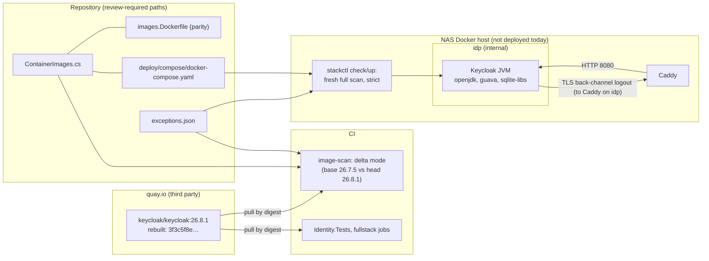

<!-- gate: G3 | verdict: PASS-WITH-NOTES | issue: #268 -->
# Threat delta: bump Keycloak to 26.8.1, the rebuilt digest (#268)

- Scope: the planned change only. The Keycloak pin moves from `26.7.5@sha256:37dbaf6f0722…` to `26.8.1@sha256:3f3c5f8e03c614774b4bd9173b88391fefa4153bfc010d8012d59ad825377332` (amd64 `de6ed510…`, Marco 2026-11-03, option A). The `keycloak` entries in `.github/image-scan/exceptions.json` are replaced, and the keycloak expiry cap in `deploy/tests/test_stackctl.py` is changed. No change to `image_scan.py`, ADR-0015, ADR-0022, the realm files, the wrapper or the Compose overlay. Areas the change does not touch are not re-audited.
- Sources read: manifest `docs/ai/pipeline/268.md`; ADR-0014 item 4; ADR-0015 with its amendments; ADR-0022; `exceptions.json`; `image_scan.py` (`exception_errors`, `evaluate`, `_keeps_fixed_exception`, `select_mode`, `compare_alias`, `new_findings`); `src/Decisya.AppHost/ContainerImages.cs`; `.devcontainer/engine/images.Dockerfile`; `deploy/compose/docker-compose.yaml` (Keycloak service); `deploy/compose/docker-compose.stack.yaml` (Keycloak networks, `cap_drop`); `deploy/keycloak/entrypoint-stack.sh`; `deploy/keycloak/production/realm-decisya.json` (searched); `deploy/tests/test_stackctl.py:696-711`; `.claude/tests` and `deploy/tests` (searched for keycloak caps and the finding ids); `tests/Decisya.Identity.Tests/Production/ProductionKeycloakStack.cs`; `ci.yml:76-99` (lanes); the `keycloak` skill; D-008 as Decisya records it (`docs/PHASE-0.md` waiver, `docs/security/asvs-l2.md:71-74`); the earlier rulings `image-scan-keycloak-libc6-190.md` (N-1) and `image-scan-drift-195.md`.
- The scan figures are the orchestrator's (manifest, 2026-11-03), used as data. Grype v0.120.0, amd64, one database built 2026-11-03 06:20 for all three runs.

## Verdict

**PASS-WITH-NOTES.** The rebuild is the right pin: it clears the request-path High that makes this bump due (jackson-databind CVE-2026-91777), the openjdk High CVE-2026-91415, the ca-certificates Critical CVE-2026-114406 and the six `pcre2` entries, and it leaves 1 Critical and 3 High. Three of those four can take a 30-day S-120-07 exception on the reachability arguments below (E-1 to E-3). Guava has no exception route. It does not block this PR, but it keeps the deploy gate shut, and the issue's Done-when must say so (M-5). Merge depends on M-1 to M-5. No High or Medium flaw was found in unchanged code.

The finding that changes the plan is **M-1**. The chosen digest was pushed after Ostium's 2026-11-02 scan, so it is inside ADR-0014's 7-day cooldown. Ostium's digest `a78d6b79…` (pushed 2026-10-23) is past it. Every earlier pin moved inside the cooldown carried Marco's recorded one-off waiver (#142, #185, #195). Option A did not record one.

## Data flow



Trust boundaries: quay.io → repository (a third-party image enters by digest); repository → CI (the scan and the suites decide what merges); repository → host (`stackctl` decides what runs). Browser, BFF and API flows are unchanged.

## Threats

| Id | Element / flow | STRIDE | Threat | Severity | Mitigation | ASVS 5.0 id | Status |
| --- | --- | --- | --- | --- | --- | --- | --- |
| T268-01 | quay.io → pin | T, S | The rebuilt `26.8.1` digest is younger than the 7-day cooldown, and Ostium's suite did not run on it. A hijacked or broken rebuild would have no week to be noticed. | Medium | Digest pin; M-1 (wait out the cooldown or a recorded waiver); M-4 (java-archive inventory equal to Ostium's digest, so only OS layers differ); Decisya's suites on the digest (M-5) | V15.1.1, V15.2.1 | Open: M-1, M-4 |
| T268-02 | Keycloak JVM trust store (CVE-2026-91403) | S, I | A TLS client in the JVM trusts the weak-key eMudhra roots, so a man in the middle could impersonate an outbound TLS peer. | Medium (Grype Critical; Red Hat 6.8, AC:H, UI:R) | Only outbound TLS peer is the back-channel logout to Caddy on internal `idp`; no egress network; no IdP, SMTP or JWKS URL in the realm (checked: none in `realm-decisya.json`); E-1, 30 days | V12.3.2, V15.2.1 | Mitigated by E-1 |
| T268-03 | sqlite-libs (CVE-2026-119373, CVE-2026-119586) | T, D | An OS library flaw reached through Keycloak. | Low, if not loaded | Keycloak's store is Postgres over JDBC; E-2 and E-3 only after the G4 load evidence in M-2 | V15.2.1 | Open: M-2 evidence |
| T268-04 | Bundled guava (GHSA-xxph-c9ww-hj94) | T, D | A fixed `java-archive` finding on Keycloak's request path that no Keycloak release fixes. | High | No exception route (ADR-0015 D-2; ADR-0022 item 2). The deploy gate refuses `check` and `up`, and the stack is not deployed (Phase 0 waiver, D-008). Tracked as drift; this PR adds nothing new for it (present at the base). | V15.1.1, V15.2.1 | Accepted residual: deploy blocked, D-008 |
| T268-05 | `exceptions.json` shared with #265 | T | Two PRs edit the same keycloak entries: a duplicate key (the validator rejects the whole file), a lapsed 26.7.5 entry renewed for an image no longer pinned, or one PR undoing the other. | Medium | M-3: #268 owns every `keycloak` entry; #265 owns none | V15.2.1 | Open: M-3 |
| T268-06 | Pin copies | T | The stack runs an image other than the one scanned and tested. | Low | Three copies change together (M-4); `ContainerImageParityTests` and the Compose guard (`stackguards.py:873`, `test_compose_guards.py`) hold them equal | V15.2.1 | Mitigated |
| T268-07 | 26.7 → 26.8 behaviour | T, E | A renamed or removed server option is ignored at start. The case that matters is `KC_PROXY_TRUSTED_ADDRESSES`: if it were dropped, forwarded headers would be trusted from any peer on `idp`. | Medium | The suites cover the production start, realm import, admin MFA, events, the BFF login and the E2E flow (M-5). The options no test sets get a release-notes check (M-5). | V13.1, V10, V6, V7 | Open: M-5 |

## Must (G4 and G7)

- **M-1. Cooldown (T268-01).** G4 records the push time of `sha256:3f3c5f8e…` from the quay.io tag API, and the immutable `26.8.1-<n>` build tag that carries it, in the manifest. The PR merges no earlier than push time + 7 days, **or** Marco records a one-off cooldown waiver for this digest in the manifest, worded like the #142, #185 and #195 waivers ("sets no precedent"). My recommendation: wait. A rebuild pushed on 2026-11-02 or 11-03 clears the cooldown by 2026-11-10, inside the 2026-11-16 deadline. The risk of waiting: if the tag is rebuilt again before then, the pin is still valid, but item 3's tag state reads `moved`. That only affects fixed OS findings, and there are none today.
- **M-2. Exceptions (T268-02, T268-03, T268-04).** G4 writes exactly E-1, E-2 and E-3 below, with Marco's approval date, and no guava entry. Before writing E-2 and E-3, G4 records evidence on this digest (`--network none`): the started Keycloak JVM maps no `libsqlite3` (its `/proc/<pid>/maps`), and no file under `/opt/keycloak` bundles an SQLite library or JDBC driver. If either fact fails, there is no entry: stop and report. Before writing E-1's ca-certificates sentence, G4 confirms from the rebuild's scan JSON that `ca-certificates` no longer matches CVE-2026-114406. If it still matches, that sentence is dropped.
- **M-3. 26.7.5 entries and the #265 split (T268-05).** In #268, G4 removes all nine current `keycloak` entries (list below) and edits `deploy/tests/test_stackctl.py:703-705`. `keycloak` leaves the `<= "2026-11-02"` tuple. In its place goes a keycloak-only assertion: every `keycloak` entry has `issue` `#268` and `expires <= "2026-12-03"`. The 30-day S-120-07 loop at `:708-711` stays as it is. #265 touches no `keycloak` entry. It edits only the postgres and redis half of that cap block, and whichever PR merges second rebases that block.
- **M-4. Pin and evidence (T268-01, T268-06).** The new reference goes into all three copies together: `ContainerImages.cs` (with a provenance comment that names option A, D-008 point 5 and the digest read two ways), `images.Dockerfile`, and `deploy/compose/docker-compose.yaml:41`. G4 evidence in the manifest:
  - (a) the PR's `image-scan` runs in **delta** mode (only lane paths: the pin, the parity file and `exceptions.json`). Its log shows `keycloak … 0 new blocking`, and the four remaining findings show `at base` or `excepted`;
  - (b) jackson-databind CVE-2026-91777 is absent at the head;
  - (c) the `java-archive` component set (name and version) of `3f3c5f8e…` equals that of Ostium's `a78d6b79…`, read from the same Grype runs' SBOMs. Then the rebuild differs only in OS packages, and Ostium's test result carries over to the Keycloak distribution. If the sets differ, stop and report.
- **M-5. Tests and the Done-when (T268-04, T268-07).** Green on the new digest, before the PR: the full `Decisya.Identity.Tests` suite, including `Category=Integration` (the dev realm, the `Production/` stack tests and the realm guard), `deploy/tests`, the `.claude` suite and, in CI, the fullstack jobs (AppHost tests, E2E and ZAP; `ContainerImages.cs` is in that lane). G4 also records that the Keycloak 26.8.0 and 26.8.1 upgrading notes rename, remove and re-default none of the options the stack sets. Those options are: `KC_DB`, `KC_DB_URL`, `KC_DB_USERNAME`, `KC_DB_PASSWORD`, `KC_BOOTSTRAP_ADMIN_USERNAME`, `KC_BOOTSTRAP_ADMIN_PASSWORD`, `KC_HOSTNAME`, `KC_HOSTNAME_ADMIN`, `KC_HTTP_ENABLED`, `KC_PROXY_HEADERS`, `KC_PROXY_TRUSTED_ADDRESSES`, `KC_HEALTH_ENABLED`, `KC_TRUSTSTORE_PATHS`, `start --import-realm` and the plain `${X}` placeholders. No test sets `KC_HOSTNAME_ADMIN`, `KC_PROXY_TRUSTED_ADDRESSES` or `KC_TRUSTSTORE_PATHS`. If any of these options changed, stop and report; no fix inside #268 without a G3 re-check. G7: the issue's Done-when cannot be met for guava ("every finding has an approved, time-limited exception"). Marco records the amended Done-when in the manifest before G7: guava is excepted from it, stays tracked under D-008 and as drift, and the deploy gate keeps refusing until a Keycloak release carries guava 33.7.2 or later.

## Should

- S-1. Pin the immutable `26.8.1-<n>` tag instead of `26.8.1` only if Marco wants Dependabot to stop proposing same-version rebuilds. Not needed for safety, because the digest is the pin.

## Exception entries (E-1 to E-3)

The entries assume Marco approves on 2026-11-03. If he approves on a later date `D`, then `added` = `D`, the phrase reads `approved by Marco D`, and `expires` is at most `D` + 30 days. The cap in M-3 moves with it. All three end on the same date, so one issue re-checks them. The deploy gate stays shut for guava anyway. These entries matter for the Done-when, for drift tracking (ADR-0022 item 2: an approved exception closes a finding) and, later, for a deploy once guava is fixed. A Red Hat fix for E-1 to E-3 would be an `rpm` fix: item 3 then keeps the entry only while the tag still resolves to the pinned digest, and a Keycloak rebuild ends it at once.

E-1 replaces the current `CVE-2026-91403` / `java-21-openjdk-headless` entry (#195). It does not sit beside it, because the validator rejects a duplicate (image, package, id).

```json
{
  "id": "CVE-2026-91403",
  "image": "keycloak",
  "package": "java-21-openjdk-headless",
  "justification": "CVE-2026-91403, java-21-openjdk-headless 1:21.0.13.0.9-1.2.el9 in the Keycloak 26.8.1 image (sha256:3f3c5f8e03c6...): the OpenJDK CA store trusts roots that signed eMudhra intermediates with weak private keys (CWE-295); fix state: not-fixed. Grype rates it Critical; Red Hat CVSS 3.1 is 6.8 (preliminary) AV:N/AC:H/PR:N/UI:R/S:U/C:H/I:H/A:N. This package is the JVM that serves Keycloak and it is loaded. Its default trust store is the system ca-certificates store (Red Hat's statement for the RHEL OpenJDK RPMs). In the same Grype database (built 2026-11-03) this image no longer matches CVE-2026-114406 for ca-certificates, which 26.7.5 does; this entry still rests on reachability alone. Keycloak trusts the store as a TLS client (KC_TRUSTSTORE_PATHS adds the Caddy root to it and does not replace it); browsers do not use this store. Deployed context (#120, ADR-0018 D2): Keycloak is on the internal idp and pg-kc networks only; Caddy admits the LAN to /realms/decisya* and /resources/* on 8443 and the workstation to the admin paths on 8444, and port 9000 is never routed; the stack is not deployed today, and the deploy gate refuses while Keycloak's bundled guava (GHSA-xxph-c9ww-hj94) has no fixed release (ADR-0022, D-008). Reachability: Keycloak's only outbound TLS peer is the back-channel logout call to the app host, which resolves to Caddy's fixed address on the internal idp network; JDBC to Postgres is plaintext on the internal pg-kc network, so no CA store is involved; the realm has no identity provider, no SMTP server and no client JWKS URL; Keycloak has no network with egress. A man in the middle needs a position on idp, which holds only Caddy and Keycloak (both with all capabilities dropped, NET_RAW included), or root on the Docker host, and either is already a compromise of the identity tier. Void if any of these changes: any egress network for Keycloak, any outbound peer outside idp and pg-kc, or an identity provider, SMTP server or client JWKS URL in the realm. Keycloak is on the request path of a LAN-reachable service, so under G3 S-120-07 the approval is recorded here: issue #268, approved by Marco 2026-11-03; added 2026-11-03, expires 2026-12-03, 30 days. Not renewed past this expiry without a new issue and a fresh G3.",
  "issue": "#268",
  "added": "2026-11-03",
  "expires": "2026-12-03"
}
```

E-2 (and E-3: the same text with `CVE-2026-119586` in `id` and in the first words of the justification):

```json
{
  "id": "CVE-2026-119373",
  "image": "keycloak",
  "package": "sqlite-libs",
  "justification": "CVE-2026-119373, sqlite-libs 3.34.1-11.el9_8 (rpm) in the Keycloak 26.8.1 image (sha256:3f3c5f8e03c6...): Grype rates it High; fix state: not-fixed. sqlite-libs is an operating-system library of the image's base. Reachability (G4 evidence on this digest, docker run --network none, recorded in docs/ai/pipeline/268.md): the started Keycloak JVM maps no libsqlite3, and no file under /opt/keycloak bundles an SQLite library or JDBC driver; Keycloak's store is Postgres over JDBC on the internal pg-kc network, so no request to Keycloak reaches SQLite code. Deployed context (#120, ADR-0018 D2): Keycloak is on the internal idp and pg-kc networks only; Caddy admits the LAN to /realms/decisya* and /resources/* on 8443 and the workstation to the admin paths on 8444, and port 9000 is never routed; the stack's bind-mount table admits no provider or theme JAR; the stack is not deployed today, and the deploy gate refuses while Keycloak's bundled guava (GHSA-xxph-c9ww-hj94) has no fixed release (ADR-0022, D-008). Void if the Keycloak JVM or any provider JAR loads SQLite, or if the bind-mount table admits a provider JAR. Keycloak is on the request path of a LAN-reachable service, so under G3 S-120-07 the approval is recorded here: issue #268, approved by Marco 2026-11-03; added 2026-11-03, expires 2026-12-03, 30 days. Not renewed past this expiry without a new issue and a fresh G3.",
  "issue": "#268",
  "added": "2026-11-03",
  "expires": "2026-12-03"
}
```

**Guava, GHSA-xxph-c9ww-hj94: no entry.** It is a fixed `java-archive` finding. Under D-2 an upstream fix ends an exception at once. Item 3 covers OS packages only. Item 4 covered Caddy `go-module` only, and ADR-0021 retired it. An entry would pass the validator, but `evaluate()` voids it ("exception not applied: a fix is now available"), so it would read as an acceptance that does not exist. What that means:

- **PR gate (ADR-0022 item 1, delta).** It passes on guava, provided the key `(keycloak, guava, java-archive, GHSA-xxph-c9ww-hj94)` is in the 26.7.5 base scan at High or above. ADR-0022 records it there since 2026-10-30. M-4 (a) proves it on the run. If it shows as new, the PR is red and cannot merge: stop and report.
- **Deploy.** `stackctl check` and `up` keep refusing, as today, until a Keycloak release carries guava 33.7.2 or later and is pinned. #29 and #132 stay blocked (Phase 0 waiver, D-008).
- **Drift.** It stays a tracked High with a 14-day request-path deadline from first seen, at the latest about 2026-11-13. When it passes, it becomes OVERDUE, which notifies and never blocks a PR. Any route round D-2 needs a new ADR-0015 amendment and its own G3 (ADR-0022 item 2).

## 26.7.5 entries: the split between #268 and #265

| Entry (image keycloak) | Issue | Expired | Owner | Reason |
| --- | --- | --- | --- | --- |
| CVE-2026-86145 `pcre2` | #83 | 2026-11-02 | #268 removes | Not a High or Critical on the rebuild |
| CVE-2026-89161 `pcre2` | #83 | 2026-11-02 | #268 removes | Same |
| CVE-2026-103111 `pcre2` | #83 | 2026-11-02 | #268 removes | Same |
| CVE-2026-86145 `pcre2-syntax` | #83 | 2026-11-02 | #268 removes | Same |
| CVE-2026-89161 `pcre2-syntax` | #83 | 2026-11-02 | #268 removes | Same |
| CVE-2026-103111 `pcre2-syntax` | #83 | 2026-11-02 | #268 removes | Same |
| CVE-2026-91415 `java-21-openjdk-headless` | #190 | 2026-11-02 | #268 removes | Fixed in the rebuild (openjdk 1:21.0.13.0.9) |
| CVE-2026-114406 `ca-certificates` | #190 | 2026-11-02 | #268 removes | No longer matched on the rebuild |
| CVE-2026-91403 `java-21-openjdk-headless` | #195 | 2026-11-02 | #268 replaces with E-1 | Still present; duplicate keys are rejected |

**#265 owns no `keycloak` entry.** That includes the 26.7.5 `sqlite-libs` drift it found on 2026-11-02, which E-2 and E-3 close on the new pin. #265 keeps the `postgres` entries (CVE-2026-111497 `brotli-libs` and CVE-2026-92392 `libcurl`, #195, expired 2026-11-02) and the `caddy` go-jose entry (#212, expires 2026-11-12). The `api`, `bff` and `migrator` entries belong to neither PR.

If #265 merges first, `main` carries 26.7.5 with expired keycloak entries until #268 merges. Under ADR-0022 that is drift. It blocks no PR, and the deploy is shut by guava anyway. If #268 merges first, the keycloak part of #265's scope is gone. Either way, the only shared text is the `test_stackctl.py:703-706` block, and the PR that merges second rebases it.

## Answers to the four questions

1. Exceptions: E-1 to E-3 above, 30 days each (the S-120-07 cap, which the test also enforces), issue #268, Marco's approval in the text. Guava: none (see above).
2. The 26.7.5 entries: all nine `keycloak` entries go in #268 (eight removed, one replaced); #265 has no `keycloak` entries.
3. The rebuild needs no new test. It needs Decisya's suites on the digest (M-5) and one cheap equality check (M-4 (c)). That check shows the rebuild carries the same Keycloak distribution Ostium tested and differs only in OS layers. With it, the jump off Ostium's tested digest is a base-image refresh, which Decisya's integration suite covers. Without it, it is an untested build.
4. Behaviour from 26.7 to 26.8: I found no change in Decisya's configuration that the bump forces. The realm, the wrapper, the placeholders, the user profile, the BFF client and the realm guard are unchanged, and the realm guard is a static repository scan that does not depend on the Keycloak version. The 26.8 release notes are not among my inputs, so M-5 makes G4 check the options no test exercises.

## Could not check

- The rebuild's push time and its cooldown end (M-1).
- Whether every remaining head finding is in the 26.7.5 base scan (M-4 (a)). The manifest gives only totals for the base.
- The ca-certificates version on the rebuild, and whether the Keycloak JVM loads `libsqlite3` (M-2).
- The text of Keycloak's 26.8.0 and 26.8.1 release and upgrading notes, Ostium's O-031 notice and the wording of D-008 point 5: none are in Decisya's repository, and I did not open the exchange.
- arm64: only amd64 is scanned (ADR-0015, an existing residual, not re-audited).
