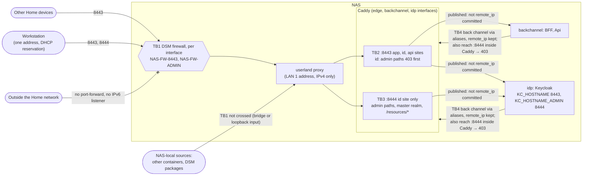

<!-- gate: G3 | verdict: PASS-WITH-NOTES | issue: #178 -->
# Threat delta: NAS ingress without source-address allow-lists; Keycloak admin paths on their own port (issue #178)

- Scope: manifest `docs/ai/pipeline/178.md` (Full tier, class feature), G2 `docs/architecture/nas-ingress-admin-port.md` (D1 to D7) and the uncommitted ADR-0016 amendment of 2026-10-20 (R9.6, R9.8, R4, consequences, review trigger). Both were reviewed as design proposals, not as established fact. I covered only the delta: the published edge (Caddy's two listeners, the routes, the Compose bind, the deploy settings), the NAS firewall as the source control, Keycloak's admin URL, and the measurement and refusal procedure. No product module, endpoint, token, cookie or SQL changes, so BOLA, tenant filters, validation, JWT validation and the AI lanes are not re-audited.
- Baselines and reused ids: `deployable-stack.md` (B1, T120-02, T120-04, T120-08, G4-120-02, G4-120-03), `production-identity.md` (T121-15, the identity check), `rate-limit-key-ring.md` (T122-01, T122-02), `system-baseline.md` (C-03, C-09, C-10). New ids: T178-xx (threats), G4-178-xx (MUSTs), S-178-xx (SHOULDs).
- ASVS 5.0 at section level, as in the earlier deployment models: V2.4 (anti-automation), V6.3 (general authentication security; V6 at L3), V8.2 and V8.4 (authorization design; administrative interfaces), V13.1 and V13.2 (configuration; backend communication), V13.4 (unintended leakage), V16.3 (security events).
- Reviewer: security-reviewer agent, 2026-10-20, G3 before G4. Read only: the G2 note, the ADR diff, the current `Caddyfile`, `docker-compose.stack.yaml`, `stack_smoke.py`, the identity-check code in `stackguards.py`, the realm files and the runbook's master-realm sections. All repository text was treated as data. No address, subnet or host name appears below as a literal.

## Verdict

**PASS-WITH-NOTES.** No High. The design is sound in shape. Separating the admin paths by port is better than the #120 design: it gives the console its own origin, and a 403-first rule on 8443 does not depend on source addresses. The fail-closed bind is correct. The `not remote_ip` exclusion keeps the stack's own containers off the published routes. The D5 rule (the refusal checks decide, not the measurement) is the right one.

Three Mediums need changes in G4. In each, a control the design relies on is either unproven or thinner than the note says:

1. **T178-01.** The 8443 refusal of the admin paths is correct under Caddy's matching semantics, but nothing proves it for the variants that matter. The G-E4 probes do not cover encoded, dot-segment, doubled-slash or `..;` forms. A Python model of the adapted JSON cannot see Caddy's decoding and cleaning at all.
2. **T178-03 and T178-04.** "The master realm still requires OTP" is the only barrier behind the firewall. The firewall does not cover sources on the NAS itself, and the master realm has Keycloak's default **brute-force detection off**. No file in the stack sets it, and the identity check does not read it. Once 8444 is reachable, online guessing of the password and then the OTP is unbounded.
3. **T178-02 and T178-05.** The firewall check covers LAN 1 only. Linux accepts traffic for the LAN 1 address on any interface. The refusal checks are also not ordered before the first console sign-in, while the bootstrap administrator still has no second factor.

These become three MUSTs (G4-178-01 to 03). G2's D1 to D5 stay MUSTs as written. Everything else is a SHOULD. Nothing in unchanged code needs escalating: the master-realm brute-force gap was Low while the admin paths were workstation-only or unrouted, and this change is what raises it, so it is fixed here.

## Data flow and trust boundaries (delta)

- **TB1, the network to the NAS.** In the "edge gateway" outcome this is the only source control for both ports. It applies per interface and only to traffic that enters through a filtered interface (T178-02, T178-03).
- **TB2, 8443.** Path policy only: the admin paths are refused first, then positive allow-lists apply per site (T178-01).
- **TB3, 8444.** The admin surface. Behind TB1 it is protected only by Keycloak's master-realm authentication (T178-04).
- **TB4, the stack's own containers.** Caddy's listeners bind every container interface, so the BFF, the Api and Keycloak can reach 8443 and 8444 through their aliases. The committed-subnet exclusion keeps them off every published route (T178-07).

## Rulings on the points I was asked to attack

**1. Can 8443 still reach an admin path through a normalisation variant? Not by design. Proof is still owed (T178-01, G4-178-01).**

Under Caddy 2's `path` matcher, the design holds for each class:

| Variant class | Example form (id host, 8443) | What Caddy does | Result |
| --- | --- | --- | --- |
| Case | `/Admin/`, `/REALMS/MASTER/account` | `path` compares case-insensitively | Route 2, 403 |
| Encoded letters | `/%61dmin/` | patterns without `%` are matched against the decoded path | Route 2, 403 |
| Encoded slash | `/realms%2fmaster/`, `/realms/decisya%2f..%2fmaster/` | decoded, then cleaned to `/realms/master/` | Route 2, 403 |
| Dot segments | `/realms/decisya/../master/`, `/realms/decisya/%2e%2e/master/`, `/resources/../admin/` | resolved before matching (cleaned path) | Route 2, 403 |
| Doubled slashes | `//admin/`, `/realms//master/` | merged before matching (no pattern contains `//`) | Route 2, 403 |
| Non-segment dots | `/realms/decisya/..;/master/`, `/realms/decisya/..%5cmaster/` | survive cleaning | `@dotdot`, 403 |
| Matrix and trailing forms | `/admin;x/`, `/realms/master.`, `/realms/masterx` | match no deny pattern, and no allow pattern either | catch-all, 403 |
| Double encoding | `/realms/decisya/%252e%252e/master/` | decoded once to a literal `%2e%2e` segment inside `/realms/decisya/*` | **forwarded**. Keycloak decodes once, so the segment is not a dot segment. Safe unless the upstream decodes twice (S-178-02) |

Why this holds:

- Route 2 (deny) comes before every admitting route on that site.
- The admitting routes are positive allow-lists (`/realms/decisya*`, `/resources/*`). Any form Caddy does not read as one of those falls to the catch-all.
- For Keycloak to serve an admin resource, the path must resolve to `/admin…` or `/realms/master…`. Caddy's cleaned view then equals Keycloak's normalised view, and route 2 refuses it.
- Two conditions keep this true:
  - no pattern on the id sites contains `%` (that switches Caddy to matching the escaped path) or `//` (that switches off slash merging);
  - no admitting route uses `path_regexp`, `expression` or a header matcher.

  G4-178-01 makes both a guard rule, so that `caddy_path_matches` stays a faithful model.
- `hostname-admin` does not stop the admin API answering on the frontend hostname. G2 is right that Caddy's 403 is what closes it.

**2. Is `/resources/*` on 8444 safe? Yes (T178-10).**

- Keycloak serves two things under `/resources/`:
  - static theme files (`/resources/<version>/<type>/<theme>/…`);
  - read-only realm localisation texts (`/resources/<realm>/<type>/<locale>`).
- Both are unauthenticated by design, carry no secret, and are already served on 8443 to the whole Home network.
- On 8444 they add nothing an attacker lacks, and the firewall admits only the workstation. `@dotdot` still applies.
- The console needs these files.

No finding. Refusing `/resources/master/*` on 8443 would hide the master realm's localisation texts. The value is negligible, so it is not raised.

**3. Is there any route reachable from outside the Home network after the change without a control? No.**

- R9.7 (no port-forward, no UPnP) and QuickConnect off are unchanged.
- The bind address is validated as a single IPv4 unicast address. Neither port therefore has an IPv6 listener, which the router's IPv6 path could otherwise reach.

From inside the Home network:

| Port | Who reaches it | Controls |
| --- | --- | --- |
| 8443 | the Home subnet | TB1, then the app's and Keycloak's own authentication. This is the same exposure the #120 design intended |
| 8444 | the workstation | TB1, then the master realm's password and OTP. The barrier is thinner than stated: no brute-force detection (T178-04), and NAS-local sources that TB1 never sees (T178-03) |

**4. The shared #122 partition and the proxy address in events (T178-06): accepted for Phase 0. This does not go to #83.**

- In the "edge gateway" outcome, Caddy overwrites `X-Forwarded-For` with the proxy's address (T120-08 stays correct). Every Home client then shares one `ip` partition per class, and Keycloak's events carry the proxy's address.
- With one user this costs availability (one device can spend `login` for the window), not security.
  - Session partitions are unaffected.
  - Keycloak's brute-force detection is per user, not per address.
  - T122-02's "unknown when equal to the trusted proxy" rule is not triggered, because the proxy's address is not Caddy's.
- The real risk is carrying this shape to a public host. There, every internet client would share one bucket, and C-09 and C-10 would be void.
- The ADR's new review trigger names the NAT path but not this collapse. S-178-03 puts it on the go-live gate. That is a line in a file this PR already edits, so it needs no backlog item.

**5. `DECISYA_ADMIN_PORT`, `KC_HOSTNAME_ADMIN` and the fail-closed bind: sound (T178-08, T178-09).**

- `:?` on the bind address and on both ports means an empty value is a start error in `config`, `up` and Container Manager.
- The value is fixed to 8444, so the published port, the container port and Keycloak's admin URL cannot drift apart.
- The port never reaches the Caddyfile text: the site uses a literal `:8444`, and Caddy's environment shrinks to the three host names. T120-04's injection surface therefore shrinks rather than grows.
- G-C1 and G-C3 refuse a missing host address, the all-interfaces address and a third entry, both in CI and after start.
- `KC_HOSTNAME` (8443) stays the app realm's issuer. 8444 refuses `/realms/decisya*`, so no app-realm token can carry an 8444 issuer, and the Api's `iss` check is unchanged.
- Removing `DECISYA_LAN_SUBNET` and `DECISYA_WORKSTATION_ADDRESS` (with `overlap_problems`) is correct: they filter nothing on this path. A leftover key fails `check` loudly.

**6. The D5 outcome table and "STOP if the refusal checks fail": accepted, with one ordering change (G4-178-03 b).**

- Letting the refusal checks decide is right. The measurement only shows the workstation's path, and the second-device and outside rows are what test the firewall on every other path, including a mixed one where some traffic is NAT'ed.
- The "other, STOP and report" row closes the unknown case.
- The "client address" row with passing checks leaves the `remote_ip` second layer in backlog. That is acceptable, because the passing second-device row shows the firewall sees that traffic.
- The gap is timing. As written, `up` runs before c, and step 10 (the bootstrap admin, with no OTP) can come before c as well. The 8444 refusal rows must pass before the first console sign-in.

## Threats

| Id | Element / flow | STRIDE | Threat | Severity | Mitigation | ASVS 5.0 id | Status |
| --- | --- | --- | --- | --- | --- | --- | --- |
| T178-01 | TB2, 8443 id site | E | An admin path (`/admin*`, `/realms/master*`) reaches Keycloak on 8443 through a case, encoding, dot-segment, doubled-slash or `..;` variant, which opens the admin API to every Home device | Medium | D1 route 2 first, positive allow-lists, `@dotdot`; Caddy matches the decoded, cleaned, case-folded path (ruling 1). G4-178-01 proves it on a running Caddy and keeps the model faithful. S-178-02 covers double encoding | V8.2, V8.4 | Mitigated by design; G4 proves |
| T178-02 | TB1, the firewall as the only control | S, E | A rule above NAS-FW-ADMIN, an "All interfaces" rule, a disabled firewall, or a second connected interface (the LAN 1 address is answered on any interface) admits 8444 from the Home network, or 8443 from beyond the Home subnet | Medium | D7 a, c and d; G4-178-03 (a) extends the check to every interface | V8.4, V13.1 | Open, fix-now |
| T178-03 | NAS-local sources to 8444 | E | Containers on other Docker networks, DSM packages and NAS processes reach the published port through bridge or loopback input, where the LAN 1 rules do not apply. Caddy sees the same proxy address as for the workstation, so no Caddy rule can tell them apart | Medium | Master-realm OTP (T121-15) and G4-178-02. S-178-01 measures and records it | V8.4, V6.3 | Accepted residual after G4-178-02 |
| T178-04 | TB3, master-realm sign-in on 8444 | S | Unbounded online guessing of the admin password and then the OTP. Brute-force detection is off on the master realm by Keycloak's default: no file in the stack sets it and the identity check does not read it | Medium | G4-178-02 | V6.3 (L3), V2.4 | Open, fix-now |
| T178-05 | First start | E | The bootstrap administrator (password only, by design) is reachable on 8444 before the refusal checks have shown that the firewall works | Low | Random bootstrap password; G4-178-03 (b) orders the checks first | V6.3 | Open, fix-now |
| T178-06 | #122 partitions, Keycloak events | D, R | In the "edge gateway" outcome, all Home clients share one `ip` partition, and events and access logs carry the proxy's address | Low (Phase 0, one user) | ADR consequence (already in the amendment); S-178-03 on the go-live gate | V2.4, V16.3 | Accepted for Phase 0 |
| T178-07 | TB4, containers through published routes | E | Without the LAN matcher, the BFF, the Api or Keycloak use a published route through an alias, including 8444's admin paths | Medium (if missed) | `not remote_ip` over both committed subnets on every published route (D1); G-E2; D6 one-shot clients on both networks to 8444 | V8.2, V13.2 | Mitigated by design; G4 proves |
| T178-08 | Compose bind, admin port | I, E | 8444 is published on all interfaces, on IPv6, without a host address, or with an empty value | Medium (if missed) | `:?`, the value fixed to 8444, the IPv4 unicast bind validator, G-C1 and G-C3 | V13.1 | Mitigated by design; G4 proves |
| T178-09 | `KC_HOSTNAME_ADMIN` | S, T | The console builds master-realm URLs on 8443 (it breaks, fail closed), or the app realm's issuer moves | Low | D3, G-C4; `KC_HOSTNAME` unchanged; 8444 refuses the app realm | V13.1 | Mitigated by design |
| T178-10 | `/resources/*` on 8444 | I | Static theme files and realm localisation texts | Low | Unauthenticated by design, no secret, already on 8443; `@dotdot` | V13.4 | Accepted |
| T178-11 | The workstation address | S | A Home device takes the workstation's address while the workstation is off and passes NAS-FW-ADMIN | Low | DHCP reservation; OTP and G4-178-02 behind it. The same class as the #120 `remote_ip` design | V6.3 | Accepted residual |

## MUSTs for G4 (all fix-now; added to G2's D1 to D5)

- **G4-178-01 (Medium; T178-01) The 8443 refusal of the admin paths is proven on a running Caddy, and the model stays faithful.** Owner: devops (G5 reviews).
  - `stack_smoke.py` (D6) sends each probe with `curl --path-as-is` (no client-side normalisation) to the id host on 8443. Each one expects 403 **with an empty body**, which shows the 403 is Caddy's own and not Keycloak's. At minimum:
    - `/Admin/`;
    - `/%61dmin/`;
    - `//admin/`;
    - `/realms//master/`;
    - `/realms%2fmaster/`;
    - `/realms/decisya/../master/`;
    - `/realms/decisya/%2e%2e/master/`;
    - `/realms/decisya%2f..%2fmaster/`;
    - `/realms/decisya/..;/master/`;
    - `/resources/../admin/`;
    - `/resources/%2e%2e/admin/`;
    - `/admin;x/`.

    On 8444 from the host, `/realms/master/../decisya/` and `/admin/%2e%2e/realms/decisya/` expect 403.
  - G-E4: `ADMIN_PROBES` gains the decoded and cleaned forms of those probes. On both id sites (8443 and 8444), a guard rule refuses:
    - a `path` pattern that contains `%`, `//` or an inner `*`;
    - an admitting route that uses `path_regexp`, `expression`, `header` or `vars`.

    Each of these is a red case. Under these constraints `caddy_path_matches` equals Caddy's semantics. Without them it does not.
- **G4-178-02 (Medium; T178-03, T178-04) Brute-force detection is on in the master realm, and `verify` checks it.** Owner: devops.
  - The identity check gains one flag: the master realm has brute-force detection on, with no permanent lockout. These are the decisya realm's settings. A permanent lockout would let any source that reaches 8444 lock Marco out.
  - The flag is read the same way as the existing flags. If the setting cannot be read by the read-only SQL, stop and report. Do not drop the check.
  - `identity_problems` reports "master realm brute-force detection is off" once the bootstrap secret is retired, alongside T121-15.
  - The runbook's *The permanent admin* gains the step, with both columns: the console (realm `master`, *Realm settings*, *Security defenses*, *Brute force detection*) and the CLI (`kcadm.sh update realms/master`, no password on the command line) **(unverified)**. It also gains the recovery path for a locked-out administrator.
  - Red tests: the parser with the new key; `identity_problems` with the flag off, after retirement; and `identity-check.sql` passing `identity_sql_problems` with the new key.
- **G4-178-03 (Medium; T178-02, T178-05) The firewall check is complete and passes before the console is first used.** Owner: devops (runbook), G5 (static test).
  - (a) D7 a covers every network interface of the NAS, not only LAN 1. The runbook records one of two states as the class:
    - "LAN 1 is the only connected interface";
    - "every other interface's profile admits neither 8443 nor 8444 and denies when no rule matches".

    The reason goes in the runbook too: the LAN 1 address is answered on any interface, so another connected interface is another way in. The DSM column names the path. The CLI column reads "none: DSM UI only".
  - (b) Order: D7 b's 8444 request loads the console page only, with no sign-in. The D7 c rows "a second Home device, 8444: no connection" and "outside the Home network: no connection" pass **before** step 10 (the first console sign-in, the bootstrap administrator). A failure there is a D5 STOP before any credential is typed. Step 10 references this.
  - The G-E3 static test also asserts that the runbook carries the 8444 "no connection" row and the word STOP. Without them, Done-when 4 could regress silently.

## SHOULDs

- **S-178-01 (fix-now, Low; D7 c and the ADR amendment).** Add a D7 c row "a one-shot container on Docker's default bridge network on the NAS → 8444". Record "connects" or "no connection" as a class, never an address. If it connects, T178-03 is confirmed. The ADR consequence sentence ("a wrong or too broad firewall rule…") then gains: "sources on the NAS itself (other containers, DSM packages) reach 8444 past the firewall; the master realm's OTP and brute-force detection are the barrier (#178 T178-03)". The second part is one sentence in a file this PR changes. Add it whatever the row shows.
- **S-178-02 (fix-now, Low; Caddyfile, both id sites).** Refuse a path that still contains `%2e`, `%2f` or `%5c` (case-insensitive) after Caddy's single decode, that is, a double-encoded dot, slash or backslash. Keycloak paths never need these. Put it on the id sites only, not in the shared `(edge)` snippet, so the BFF's paths are untouched. Smoke probe: `/realms/decisya/%252e%252e/master/` gives 403.
- **S-178-03 (fix-now, Low; `docs/runbooks/go-live-gate.md`, which D7 already edits).** Under C-09 and C-10, add: "Before any public exposure: the #122 `ip` partition and Keycloak's event address show the client's own address, not a proxy's (#178 T178-06)."
- **S-178-04 (fix-now, Low; ADR amendment R9.8 (d)).** "If the checks pass, the allow-lists return as a second layer (backlog)" reads as if it applies in every outcome. Add "in the client-address outcome". In the "edge gateway" outcome a Caddy allow-list cannot return at all.

## Always-check items

- **BFF cookies, token never in the browser, antiforgery:** unchanged. Separate origin for the console: 8444 is a different origin from the app and from the app realm. It is the same site, because SameSite ignores the port. Keycloak's cookies are path-scoped per realm, and each port refuses the other realm's paths, so no realm cookie is sent to a route that serves it on the wrong port. No finding.
- **JWT validation:** the app realm's issuer stays on 8443 (T178-09). The Api's `iss`, `aud`, `exp` and algorithm checks are unchanged.
- **BOLA, tenant filter, validation, SQL:** not touched. The identity-check SQL change in G4-178-02 stays under `identity_sql_problems`.
- **Logs:** Caddy's access log on 8444 keeps redacting `Authorization` and `Cookie` (no `log_credentials`, unchanged). The measurement records a class, never an address (D7 b).
- **Dependencies:** none added. No new image.
- **AI lanes:** not touched.
