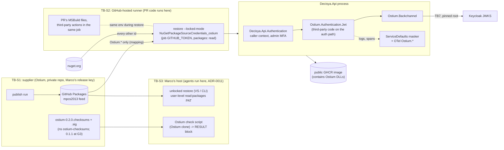

<!-- gate: G3 | verdict: PASS-WITH-NOTES | issue: #164 -->
# Threat delta: identity switch 1, Ostium Jwt and Backchannel packages (issue #164)

- **Scope.** This is a delta. It covers only what #164 adds:
  - the external supply chain (private GitHub Packages feed `mpcs2013`, `NuGet.config` with `<clear/>` and source mapping, lock files and locked restore, the signed checksums, the pinned signer line, Marco's check, key change and compromise, the 0.1.1 ASVS report gap);
  - *(2026-10-18, G6 delta: #164 ships Ostium **0.2.0** instead of 0.1.1, exchange O-013. The threats and MUSTs below apply to 0.2.0 unchanged. Where a row names 0.1.1, read it as the version that G3 reviewed on 2026-10-17. T164-21 covers the one new option in 0.2.0.)*
  - the CI permission change (`packages: read`, the job token on restore steps);
  - moving the JWT validation and back-channel trust of `Decisya.Api` into third-party code;
  - telemetry and logging of the new packages;
  - the BFF, which keeps its own trust.

  The threats of #20 (`api-jwt-validation.md`, "#20 T-nn") and #59 (`pre-push-ci-parity.md`) are not re-audited. Their mitigations are re-homed here where the code that carried them moves.
- **Mode.** Threat delta, before code. G6 checks the MUSTs against the diff.
- **Inputs.**
  - G1 `docs/requirements/phase-0/ostium-jwt-switch.md` (Stories 1 to 6, NFR-59, NFR-60).
  - G2 `docs/architecture/ostium-jwt-switch.md` (D1 to D6).
  - ADR-0019 and its amendment 2026-10-17 (A1 to A6, **Proposed**), `docs/architecture/ostium-dependency.md`, the Ostium row of `docs/compliance/standards-register.md`, FU-59-1.
  - The current `.github/workflows/ci.yml`, `release.yml`, `dependabot.yml`, `Directory.Build.targets` and the ServiceDefaults masker.
  - As data only: the exchange items O-005, O-006, O-010, and A-003 point 4 (the fork and public-image residual that Marco accepted).
- **ASVS.** 5.0 at L2, with L3 for V6 and V7. #164 does not touch V6 or V7: the BFF and the session are unchanged. Controls are mapped at section level, plus V15.2.4 for dependency confusion. Check the numbers against the official 5.0 text before they go into a compliance artefact. Supply-chain mitigations are also mapped to NIST SSDF (SP 800-218) and SLSA v1.0.
- **Runs on:** host (manifest). That is correct: the issue changes `.claude/**`. No secret value, `.env`, user-secrets or user-level `NuGet.Config` was read for this review.
- Reviewer: security-reviewer agent, 2026-10-17.

## Verdict

**PASS-WITH-NOTES.** The design is sound. Four threats are rated High, and each one has a mitigation in the design plus a MUST below:
- T164-01, a tampered package;
- T164-02, dependency confusion;
- T164-10, a silent behaviour change in the moved JWT validation;
- T164-12, Decisya's composition loosening the locked scheme. This one is Medium in likelihood but High in impact; it is listed with the Highs because it is on the auth path.

No High or Medium flaw was found in code that #164 does not change.

G3 adds four points to G2:

1. **Locked mode must not hang on one variable alone (T164-03).** A project-level `<RestoreLockedMode>false</RestoreLockedMode>` overrides `Directory.Build.props`, because the props file is imported before the project body. And no CI restore step passes `--locked-mode` explicitly. See M-1.
2. **G2 deletes Decisya's only proof of four #20 mitigations (T164-10, T164-11).** These are the pinned-options assertion and the environment-validator rows (`JwtBearerOptionsPinnedTests`, `ApiJwtOptionsTests`). 0.1.1 has no supplier report (A4), so Decisya's host-level tests are the only evidence at this version. They stay, rewritten against `AddDecisyaApiAuthentication`. See M-2.
3. **The masker sees a marker only on a type or a property (T164-13).** It cannot see an attribute on a `LoggerMessage` parameter. If Ostium marks values that way, recognising the marker by name does nothing, and only a log capture proves masking. See M-3.
4. **Fork PRs (T164-08).** G2 and amendment A6 state that a fork's token cannot read the private packages. GitHub's documentation, as quoted in A-003 point 4, says forks *may* be able to. Marco has already accepted that residual. The wording must match it (S-1).

## Rulings asked for

### 1. G2's `DECISYA_LOCKED_RESTORE` switch: acceptable, under M-1

- **Why the switch is right.**
  - An explicit, non-secret variable set at workflow level also covers the implicit restores inside `dotnet build` and `dotnet test`, and inside the harness scripts.
  - `GITHUB_ACTIONS` would be the wrong key, because Dependabot's updater can itself run on Actions runners.
  - Local unlocked restore keeps the lock files maintainable. Any rewrite shows in the diff, and the pre-push check warns on it and restores locked.
- **Dependabot.** "Dependabot never sets it" applies to the updater only. The CI run on a Dependabot PR has the workflow-level variable set, so every Dependabot PR is still restored in locked mode in CI. That is the property that matters.
- **What makes the switch fragile.** It is one condition in one file. It also depends on a property that a project can set back, and the canary turns it off on purpose. M-1 closes these three gaps:
  - every explicit restore passes `--locked-mode`, which is a global property and wins over project properties;
  - a build-policy error stops a project from opting out;
  - static tests pin the variable and the single permitted opt-out.

### 2. Does any MUST depend on Marco accepting the ADR-0019 amendment?

- **M-1, M-2, M-3 and M-5 do not.** They rest on ADR-0019 decisions 1 and 5 (Accepted: source mapping, exact pins, lock files, locked restore in CI), on FU-59-1 (the G3 follow-up of #59), and on CLAUDE.md's security principles.
- **M-4 does, in effect.** Accepted decision 4 needs a SHA-512 signed with the pinned key before merge. The only signed values that exist for 0.1.1 are the A1 checksums file, in namespace `ostium-checksums`. That file verifies only with the two-namespace line of A2, through the A3 check.
  - If Marco accepts A1 to A3, M-4 applies as written.
  - If he changes them, M-4 follows the accepted text.
  - If he rejects them, decision 4 cannot be met for 0.1.1, and #164 cannot merge.

  This matches G2's step 0: Marco accepts before G4 starts. The G3 verdict does not change either way.
- **A4 (the report gap).** G3 accepts the gap only with M-2 as the compensating control. If Marco instead requires a report, #164 waits for the first Ostium release that has one.
- **A5 (key compromise) and A6 (Dependabot)** carry no MUST.

## Data flow and trust boundaries

- **TB-S1 to TB-S2/S3 (new).** The packages are trusted only once the content hash in the lock file matches, and that hash equals the signed checksum. The feed and the GitHub account are *not* trust anchors.
- **TB-S2 (changed).** The job token gains `packages: read`. PR-controlled MSBuild runs in the same process as the restore that holds the credential.
- **TB-S3 (new for Decisya).** Marco's check script is the only signature verification. It runs on the host that also holds the release key and runs agents.
- **In-process (new).** Third-party code now decides authentication. Decisya keeps caller context, tenancy and admin MFA. TB5 and TB7 of #20 are unchanged in behaviour.

## Threats

| Id | Element / flow | STRIDE | Threat | Severity | Mitigation | ASVS 5.0 / SSDF / SLSA | Status |
| --- | --- | --- | --- | --- | --- | --- | --- |
| T164-01 | Feed → restore | T | The pinned version (0.1.1 at G3; 0.2.0 from 2026-10-18) is replaced or republished on the feed: a compromised publish token, a hijacked account, or Ostium CI | High | Lock-file `contentHash` + locked restore (NU1403); static hash constants equal the signed checksums; the A3 check (tag and checksums signatures, SourceLink commit equals the tag commit) | V15.2, V15.1; SSDF PW.4.1, PW.4.4; SLSA v1.0 consumer verification | M-1, M-4 |
| T164-02 | Source selection | S, T | `Ostium.*` squatted on nuget.org; a non-Ostium id served from the private feed; a project or CLI adds its own source | High | `<clear/>`, two sources, most-specific mapping, `auditSources` nuget.org only; DECISYA0008; no `--source`/`-s` on any CI restore | V15.2.4; SSDF PW.4.1 | G2 static test, M-1 |
| T164-03 | Locked mode | T | Locked mode is off without anyone noticing: the variable is dropped or overridden, a csproj sets `RestoreLockedMode=false`, the canary's opt-out spreads, or a NuGet cache restores a pre-populated global folder (locked mode trusts `.nupkg.metadata`, it does not re-hash) | Medium | M-1 | V15.2; SSDF PO.3.2 | M-1 |
| T164-04 | Version pins | T | A floating range, or 0.1.0, enters a build input | Low | Exact pins, lock files, static test item 2 | V15.2 | G2 |
| T164-05 | Merge evidence | R, T | The RESULT block belongs to an earlier head (lock files regenerated after the check), or is missing, or someone else pasted it; CI cannot verify signatures | Medium | M-4: the block names the head commit it checked, and that commit is the merged head, or later commits touch no supply-chain file | V15.1; SSDF PW.4.4 | M-4; the CI gap is accepted (A3) |
| T164-06 | Signer key | S | Planned key change, or suspected compromise. The private key sits on the host where agents run | Medium | A2: one line, byte-exact, fingerprint checked on Marco's machine; A5 handling; locked hashes keep checked versions usable | V15.2; SSDF RV.2.2 | A2/A5 by review; B-2 |
| T164-07 | CI token scope | I, E | PR MSBuild code reads `NuGetPackageSourceCredentials_ostium` during restore. Third-party code in the jobs that gain `packages: read` (`gitleaks-action`, which already gets the token; the tag-referenced commitlint image, which takes the default token) can read the private packages | Low | The token is read-only, job-scoped and expires at job end; `packages: read` only on the jobs that restore; the env var only on restore steps; no PAT, no `secrets.*` for the feed, no `pull_request_target`. Remaining exposure is the compiled packages, accepted in A-003 point 4 | V13.3, V13.2; SSDF PO.5.1 | M-5 |
| T164-08 | Fork PRs | I | A fork PR may be able to restore the private packages (GitHub's documented warning), contrary to G2 and A6 | Low | Accepted residual (A-003 point 4); first-time contributor approval; Marco redoes version changes on his own branch (A3) | V13.3 | S-1 |
| T164-09 | Dependabot | D, E | Dependabot cannot read the feed or update lock files, so NuGet security updates for the Api graph stop; pressure to add a PAT | Low | No PAT without an ADR change; `ignore: Ostium.*`; the weekly scheduled CI run keeps NuGetAudit and `--vulnerable` detection; Marco decides (A6) | V15.2; SSDF RV.1.1 | S-6 |
| T164-10 | JWT validation in the package | S, E | The pinned version (0.1.1 at G3; 0.2.0 from 2026-10-18) differs from 79eb3d2 in a way the black-box rows miss: algorithm list, `ValidIssuer` pin, `RequireExpirationTime`, `SaveToken`, `MapInboundClaims`, `typ`, `IncludeErrorDetails`, refresh intervals; no supplier report exists | High | Decisya's host-level suite unchanged in expectation; M-2 keeps the pinned-options snapshot and the critical rejection rows | V9.1, V9.2, V10.3, V11; SSDF PW.8.2 | M-2 |
| T164-11 | Start-up configuration | S | An audience that is missing, `*` or padded; missing event settings; Production with an http authority or `RequireHttpsMetadata=false` is no longer tested in Decisya (#20 T-05) | Medium | Ostium `ValidateOnStart`; Story 3 tests; M-2 keeps the environment rows | V13.2, V9.2, V12.3 | M-2 |
| T164-12 | Decisya composition | E, S | Decisya code after `AddApiAuthentication` adds a scheme, changes the default or forward scheme, resets `FallbackPolicy`, or (B7 allows it) replaces `OnChallenge`/`OnForbidden` (body leak) or `OnMessageReceived` (token from the query string) | High | NetArchTest: `Decisya.Api` has no JwtBearer or IdentityModel dependency; B7 lock; `FallbackPolicyTests`, `ChallengeResponseTests`; M-2 scheme-set test | V8.2, V8.3, V9.1, V16.5 | M-2 |
| T164-13 | Logs | I | Token or claim values in the new `Ostium.Authentication.Jwt` category; Ostium's marker on a `LoggerMessage` parameter, which the processor cannot see; the package sets `ShowPII` or `LogCompleteSecurityArtifact` (the #20 source scan does not cover binaries) | Medium | M-3; M-2 checks the `IdentityModelEventSource` flags at run time | V16.2, V16.3, V14.2 | M-3 |
| T164-14 | Telemetry | I, D | Ostium spans or metrics carry raw `sub`, `tenant_id` or token fragments, or high-cardinality tags | Low | S-4 | V16.2 | S-4 |
| T164-15 | Package content | E | `build/`, `buildTransitive/`, `analyzers/` or `tools/` content in an Ostium nupkg runs at build time on CI and on the host | Low | Signed chain; S-3 records the content | V15.2; SSDF PW.4.4 | S-3 |
| T164-16 | Transitive graph | T | Ostium pulls in a new third-party package id | Low | CPM transitive pinning, lock file in the diff, nuget.org mapping, NuGetAudit; G6 check | V15.2, V15.1 | G6 |
| T164-17 | BFF trust | T | The BFF's `BackchannelRoot` and Ostium's diverge, and a fix lands in Ostium only | Low | BFF unchanged and switched next (ADR-0019 decision 2); static test: no `Ostium.` in the BFF | V12.3 | Accepted |
| T164-18 | Advisory coverage | I | NuGetAudit (nuget.org) never reports Ostium advisories | Low | Ostium announces security releases (A-003 point 2); bumped by hand at once; never auto-merged | SSDF RV.1.1 | Accepted |
| T164-19 | Public images | I | Public GHCR images ship Ostium's compiled code | Low | No Decisya control depends on Ostium being secret; accepted in A-003 point 4 | V13.4 | Accepted |
| T164-20 | Credential fallback | I | If the SDK ignores the env var, G2's fallback writes the token to the runner's user-level `NuGet.Config`, where later steps in the job can read it | Low | S-5 | V13.3 | S-5 |
| T164-21 *(2026-10-18, 0.2.0)* | Deployment configuration | T | `Api__Jwt__ResourceMetadataUrl`, the new optional 0.2.0 setting, is set in a deployment environment without review, and every 401 then carries `resource_metadata="<value>"` | Low | Unset in Decisya. Ostium validates the value (absolute https, no user info or fragment, no `"` or `\`), stops start-up when it is invalid, and never derives it from the request. Setting it needs the same access as setting `Api__Jwt__Authority`. The BFF ignores the parameter. `ChallengeResponseTests` pins the bare challenge on the test host only | V13.2 | B-4 (G6 S-164-03) |

## Requirements for G4

Five MUSTs, all **fix-now**.

- **M-1. Locked restore with hash pinning that cannot be switched off silently (T164-01..03; NFR-59, FU-59-1).**
  - Every explicit restore passes `--locked-mode` on the command line: in `ci.yml`, in `release.yml` and in `prepush.py`. That is in addition to the workflow-level `DECISYA_LOCKED_RESTORE: "true"`. A static test (in `test_ci_fullstack.py` or `deploy/tests`) asserts:
    - both workflows declare the variable at workflow level, and no job or step `env:` redefines it;
    - every `dotnet restore` in both workflows carries `--locked-mode`;
    - no workflow passes `--source`, `-s`, `--configfile` or `RestoreSources` to a dotnet command;
    - `RestoreLockedMode=false` appears only in `.github/scripts/dependency_canary.py`.
  - **DECISYA0009** in `Directory.Build.targets`, next to 0007 and 0008: when `'$(DECISYA_LOCKED_RESTORE)' == 'true'`, `RestoreLockedMode` must be `true`. `test_build_policy.py` gets red and green fixtures. The canary passes `-p:RestoreLockedMode=false` as a global property, so its exemption must be explicit: either the canary also passes `-p:DECISYA_LOCKED_RESTORE=false`, or the error is skipped for its project. G4 picks one, and the static test above pins it.
  - No NuGet package cache in any job that restores: no `cache:` on `setup-dotnet`, and no `actions/cache` over `~/.nuget/packages`. The static test asserts both.
  - Locked mode is never switched off for the release build. The `-r linux-x64` target is in the lock files (G2's `RuntimeIdentifiers` route).
  - G5 evidence (scratch copy, never `git stash`): an edited `Ostium.*` `contentHash` fails with NU1403 and a nonzero exit, and no other source is queried. Do the same with a csproj that sets `RestoreLockedMode=false` while the variable is set: it must fail with DECISYA0009.
- **M-2. Decisya keeps host-level proof of every #20 High or Medium mitigation that moves into the package (T164-10..12; Story 2, NFR-60).** This is the compensating control for the A4 gap. Each test goes through Decisya's real `AddDecisyaApiAuthentication`, not through Ostium's own registration.
  - **Pinned snapshot, kept and retargeted. Do not delete it.** Resolve `IOptionsMonitor<JwtBearerOptions>.Get("Bearer")` from Decisya's host and assert:
    - `ValidAlgorithms` is exactly {RS256, ES256};
    - `ValidAudience` is `decisya-api`;
    - `ValidIssuer` is the configured authority with the trailing `/` trimmed;
    - `ClockSkew` is 60 s;
    - `ValidateIssuer`, `ValidateAudience`, `ValidateLifetime`, `RequireExpirationTime`, `RequireSignedTokens` and `ValidateIssuerSigningKey` are true;
    - `SaveToken`, `IncludeErrorDetails` and `MapInboundClaims` are false;
    - `NameClaimType` is `sub`;
    - `RefreshInterval` and `AutomaticRefreshInterval` are at their defaults;
    - after the host starts, `IdentityModelEventSource.ShowPII` and `LogCompleteSecurityArtifact` are false.

    This file lives in Api.Tests, so referencing `JwtBearerOptions` there does not break the `Decisya.Api` rule.
  - **Environment rows, kept from `ApiJwtOptionsTests` and retargeted.** Use the O-004 direct-start pattern, environment `Production`:
    - an `Api:Jwt:Authority` that is missing, relative or `http://` stops start-up;
    - `RequireHttpsMetadata=false` stops start-up.

    In Development, the exact-host loopback rows of #20 G4-20-02 still hold: `localhost.evil.test`, `localhost@evil.test` and `127.0.0.1.nip.io` all leave the flag `true`. Every message names the key and never the value.
  - **Scheme set.** `IAuthenticationSchemeProvider` lists exactly one scheme, `Bearer`, and it is the default authenticate and challenge scheme. G6 check: `AddDecisyaApiAuthentication` and `Program.cs` call no `AddAuthentication`, `AddScheme`, `AddPolicyScheme` or `AddCookie`, and set neither `FallbackPolicy` nor `DefaultPolicy`.
  - **`InvalidTokenCaseCatalog` keeps every #20 G4-20-01 row unchanged in expectation:**
    - a genuine-key `PS256` token and a genuine-key `RS512` token. These are the only proof of the allow-list; G1's Story 2 list omits them, and they must not be dropped;
    - `alg` in its `none` variants;
    - HS256 with the public key as PEM and as DER;
    - an embedded `jwk` header;
    - an unknown `kid`;
    - no `exp`;
    - `typ` set to `ID`, and `typ` absent.
  - If any assertion differs from 79eb3d2, G4 stops and reports it as a supplier defect (G2 D1). G4 does not adapt the test.
- **M-3. No token, claim or marked value reaches a log through the new category (T164-13; Story 5, NFR-11).**
  - `LogCaptureTests` captures at `Debug` for `Ostium` as well, in addition to `Decisya`, `Microsoft.AspNetCore` and `Microsoft.IdentityModel`. It runs over every G4-20-05 case with canary `sub`, `email` and `preferred_username`. No record's message, state or exception contains the token, any of its segments, or a canary.
  - `OstiumMarkerMaskingTests` drives the path where **0.1.1 actually applies the marker**, which G4 records from the package: on a type, on a property, or on a `LoggerMessage` parameter. A synthetic type does not count.
    - If the marker sits only on `LoggerMessage` parameters, the processor cannot see it. G4 then reports this as Medium to the orchestrator and stops on Story 5. G4 does not mark the test as passing.
    - If the package has no marker at all, follow G2 D3.
  - `TokenRejectionEventTests` (host-level, as G2 designs it) also asserts that the 2003 record carries no claim value.
- **M-4. The merge gate binds the signed values to the commit that merges (T164-01, T164-05, T164-06; Story 1).**
  - `.github/allowed-signers/ostium` matches A2 byte for byte (one line, LF), with `-text` in `.gitattributes`. The static test pins it.
  - The three hash constants in `OstiumSupplyChainTests` equal the A1 file and O-006. *(2026-10-18: for 0.2.0, they equal the O-013 checksums file `docs/releases/0.2.0/ostium-0.2.0.checksums`. The `RESULT: PASS` block must come from the check run with `--version 0.2.0` on the commit that contains the switch, so the 0.1.1 result on `0a5d44f` does not count.)*
  - The PR carries Marco's `RESULT: PASS` block. That block names the Decisya commit it checked. At merge, either that commit is the PR head, or no later commit touches `NuGet.config`, `Directory.Packages.props`, `Directory.Build.*`, `**/packages.lock.json`, `**/*.csproj` or `.github/allowed-signers/**`. If the script does not print the commit, Marco adds it next to the block.
  - G7 does not mark the PR body ready without the block. G6 checks it.
- **M-5. The job token reaches only what restores, and nothing new reaches it (T164-07).**
  - `packages: read` appears only on the jobs in G2's D2 table. Each job-level block lists exactly `contents: read` and `packages: read` (plus `security-events: write` on `codeql`). The workflow-level block stays `contents: read`.
  - `NuGetPackageSourceCredentials_ostium` is set only on `run:` steps that restore. That means the restore steps, and `Vulnerable packages` only if G4 shows that the step needs the credential. It is never set on a `uses:` step, at job or workflow level, or written to `$GITHUB_ENV`.
  - No `secrets.*` reference is added for the feed. There is no PAT. `pull_request_target` stays banned.
  - `test_ci_fullstack.py` and `deploy/tests/test_ci_workflow.py` change to allow exactly that set, and they also assert where the env var appears.
  - `realm-guard`, `changes`, `claude-config` and `image-scan` gain no `packages` permission.

### SHOULD

**Fix-now (Low, a few lines in files this PR changes):**
- **S-1 (T164-08).** Correct G2 D2 ("Fork PRs ...", "Residual for G3") and the amendment's consequence "an outside contributor's PR cannot restore at all". The correct statement: a fork PR may be able to restore the compiled packages (GitHub's warning), and Marco accepted this residual in A-003 point 4. Recommend the repository setting "Require approval for all external contributors" for fork workflows, and record it in `docs/runbooks/ci-security-gates.md`.
- **S-2 (T164-01).** `docs/runbooks/ci-security-gates.md`: an NU1403 on an `Ostium.*` id is a compromise signal (O-006), not a cache glitch. Follow A5. Never clear it by deleting or regenerating the lock files. The same goes for agents: report the code and stop (CLAUDE.md).
- **S-3 (T164-15, T164-16).** G4 evidence lists the folders of each Ostium nupkg. Anything other than `lib/`, `sbom/` and the metadata gets a G6 look. G4 evidence also lists any non-Microsoft package id that the Ostium graph adds; each needs the one-line justification the PR body requires.
- **S-4 (T164-14).** G4 records the Ostium `ActivitySource` and `Meter` names and the tag keys they emit. If a tag carries a raw `sub`, `tenant_id` or token value, report it as Medium.
- **S-5 (T164-20).** Use G2's `dotnet nuget add source` fallback only if the env var is shown not to work. If it is used, an `if: always()` step removes the source right after the restore steps.
- **S-6 (T164-09).** If Dependabot can read the feed: put `Ostium.*` in its own Dependabot group, never mixed with third-party ids, so the branch Marco restores on the key-holding host changes only Ostium pins. If it cannot: keep the weekly scheduled CI run as the advisory detector, and note that in the A6 record.
- **S-7.** Story 2's line "tokens older than the 300 s lifespan are not accepted beyond the skew" is enforceable only through `exp`. The API does not check `exp − iat` (#20 B-2, still open). G5 must not write a test that implies max-lifetime enforcement, unless the package is shown to do it.
- **S-8.** G5 also tries the tampered hash under an *unlocked* restore and records the result. If an unlocked restore rewrites the lock file silently, the pre-push locked step and CI are the only controls on that path. That is acceptable, but it must be recorded.

**Backlog (#83):**
- **B-1.** Sandbox egress to GitHub Packages, plus a feed credential (G2 discovery 1). This is a sandbox threat-model change.
- **B-2 (T164-06).** Custody of the release key: a passphrase, or a FIDO-backed `sk-ssh-ed25519` key, on a host where agents run. This is Ostium's key, so it goes through the exchange, drafted for Marco.
- **B-3.** #20 B-1 (`azp` allow-list) and B-2 (`exp − iat` ≤ 300 s + skew) are now Ostium features. Raise them in the exchange before the second consumer goes live.
- **B-4.** A deploy check that `Api__Jwt__Audience` is set nowhere in Compose, so the shipped `appsettings.json` value cannot be overridden by an environment variable. *(2026-10-18, T164-21: `Api__Jwt__ResourceMetadataUrl` gets the same check. Preferably the check asserts that the `api` service's `Api__Jwt__*` keys are exactly `Authority` and `TrustedRootPath`.)*

## G6 checks (no new test)

- The four documents G2 D5 assigns to security-reviewer are updated at G6, once G4 has confirmed the type names: `system-baseline.md` (TB5 row, A-03 row) and `asvs-l2-baseline.md` (V9.1.1).
- `dotnet list package --vulnerable --include-transitive` shows no High or Critical. The resolved graph is at 10.0.13.
- Run `git diff` over `src/Decisya.Bff/**` and `tests/Decisya.Bff.Tests/**`. The only changes allowed are `packages.lock.json` files, and they contain no `Ostium.`.

## Accepted residuals (Marco's earlier decisions, recorded here)

- The compiled Ostium packages can reach a fork owner, and they ship in public GHCR images (A-003 point 4).
- CI cannot verify the signatures. Only Marco's RESULT block does (A3).
- 0.1.1 has no ASVS report. The Phase 0 exit audit records it as open unless Decisya has moved to a release with a report (A4). M-2 is the compensating control. *(2026-10-18: the shipped 0.2.0 has no report either, since its checksums file has no `file` line. The gap stays open, and M-2 stays the compensating control.)*
- A same-repository PR's MSBuild runs while the restore credential is in the environment. This is the same trust as today's build.

## Proportion note

T164-14 to T164-20 are recorded for completeness and change nothing in the merge decision. No High or Medium flaw was found in unchanged code. The mutable Docker Hub tag of the commitlint action is a pre-existing, accepted residual (T28-03). The only new thing #164 adds there is `packages: read` on the same job (T164-07).
