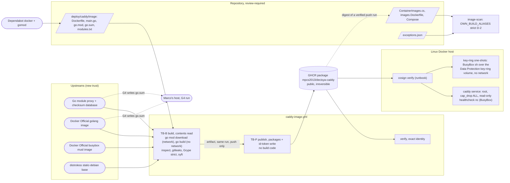

<!-- gate: G3 | verdict: PASS-WITH-NOTES | issue: #188 -->
# Threat delta: self-built Caddy edge image from source with the patched Go toolchain (issue #188)

- Date: 2026-10-22. Reviewer: security-reviewer (G3, Full tier), before G4.
- Scope: only the planned change. That is ADR-0021 (accepted by Marco 2026-10-22, M1 to M7 as proposed, T2 chosen for M5) and the G2 note `docs/architecture/self-built-caddy.md`. I reviewed both as a design, not as established fact. No product module, endpoint, token, cookie, tenant flow or SQL changes, so BOLA, tenant filters, validation, JWT validation and the AI lanes are not re-audited.
- Inputs, all read as data: ADR-0021; the G2 note; manifest `docs/ai/pipeline/188.md` (Full tier, G4 on the host); ADR-0014; `.github/workflows/release.yml`; the ADR-0017 identity and condition text; `.github/scripts/image_scan.py` (`check_provenance`, `check_binary_sbom`, `evaluate`, the item-4 constants); `.github/image-scan/exceptions.json`; `.github/dependabot.yml`; `deploy/compose/stackctl.py` (the key-ring one-shot argv); and the threat models `release-supply-chain.md` (#119), `host-development-default.md` (#56), `image-zlib-curl.md` (#183) and `nas-ingress-admin-port.md` (#178).
- Ids: T188-xx (threats), M-1 to M-5 (MUSTs, all fix-now), S-1 to S-10 (SHOULDs). Reused ids: T119-xx and G4-119-xx (#119), H-1 and C5 (#56).
- ASVS 5.0 at section level, as in the earlier deployment models: V15.1 and V15.2 (architecture, dependencies), V13.1 to V13.4 (configuration, backend communication, secrets, leakage), V12.3 (service-to-service TLS), V8.2 (authorization design), V7 (session; L3 applies), V16.3 (security events).
- No address, subnet or host name appears below as a literal. Registries and the Go services are named by role, and their exact values are the ones in ADR-0021 items 2, 5 and 7.
- I found no High or Medium in unchanged code to escalate.

## Verdict

**PASS-WITH-NOTES.** No High. The design is sound in shape and is a net reduction of the edge's attack surface:
- the pinned main module puts every Caddy source byte behind the checksum database;
- the build compiles dependency code but executes none of it;
- publishing and signing keep ADR-0017's separation under an identity that cannot be confused with `release.yml`;
- the Alpine userland that brought #120, #143 and #183 is gone.

Five gaps are Medium and become MUSTs:
1. **The build-input closure has holes the ADR does not name (M-1).** It does not cover `go.work`, a broad `COPY`, a `# syntax=` frontend that BuildKit pulls unpinned, `godebug` lines that switch Go's security defaults back, or a distroless base that plants an executable earlier on `PATH` than the BusyBox links.
2. **The new workflow must reproduce every #119 control (M-2).** In particular, publish and verify must run only on `main`, and the pin must be the verified digest of a push run.
3. **Strict D-2 on our image can pass vacuously (M-3).** distroless gives Grype a Debian distro, so `check_provenance` passes even if Grype never catalogued the Caddy binary. In that case the control that replaces item 4 would see no stdlib finding at all.
4. **T2 is acceptable only as an exact rule (M-4).** I accept it under the conditions in M-4. Without them it is a general cooldown bypass on the single most powerful build input.
5. **The host G4 run breaks H-1's premise unless Go is fenced (M-5).** The issue brings in new third-party Go modules, so G4 has to keep every Go step inside the pinned builder container.

## Data flow and trust boundaries (delta)

- **TB-S, the Go supply chain to the edge binary (new).** The module proxy and checksum database, the builder image, BusyBox and distroless all cross into an artifact that runs on the LAN-facing, pre-authentication request path (T188-01 to T188-06).
- **TB-B, build (new).** PR-controlled code runs here with a read-only token. It is the only place that executes upstream images (T188-09).
- **TB-P, the second signer (new).** The publish job holds the only write token and `id-token`. The verify identity must reject every other source (T188-09, T188-10).
- **TB-C, the CI policy for `caddy` (changed).** Strict D-2 replaces item 3 and item 4 (T188-07, T188-08).
- **TB-H, Marco's host during G4 (changed by Marco's choice).** New third-party Go content is handled on the host instead of the sandbox (T188-13).
- **Unchanged:** the edge's runtime configuration (root, `cap_drop: ALL`, `read_only`, one volume, `--network none` one-shots), the Caddyfile and Compose.

## Rulings on the six points

### 1. Supply chain of the build: what each upstream can do, and what stops it

| Upstream an attacker controls | What it can do | What stops it, or the residual |
| --- | --- | --- |
| A Caddy module or any module in the build list | It publishes a new malicious version. It cannot change an existing version: `go.sum` plus the proxy (no `direct`) fail on any byte change, and the checksum database's log makes a split view detectable. A new version reaches us only through a `go.mod` diff: Dependabot after the 7-day cooldown, a security update, or an override. Once in, its code runs in the edge as Caddy (all of `init()`, not only registered modules) | The 7-day cooldown, review of the `go.sum` diff, and overrides limited to advisory fixes (item 3). `modules.txt` catches a new or removed Caddy module, but **it is a functional check, not a malware control**: code in `init()` needs no module registration. This is the same trust we place in Caddy's release binary today. **Accepted residual, Medium inherent (T188-03).** S-1 tightens the override path |
| A `replace`, `go.work`, `vendor/`, `GOFLAGS`, `GONOSUMDB`/`GOPRIVATE` or `GOPROXY ... ,direct` path | It points the build at bytes the checksum database never saw | The ADR item 2 environment and the `replace` ban. **Gap:** no `GOWORK=off`, no explicit `COPY` list, no ban on `godebug` (T188-01, T188-02). **M-1** |
| The Go builder image | Total control. It emits any binary under any version string and also runs `go mod download`. It sees no secret: the build job holds a read-only token and no secret | Digest pin, Docker Official provenance, cooldown. T2 removes the cooldown for this pin only (M-4). The version binding in M-1 (f) catches a mislabelled image, not a malicious one. A diverse double-compile against the toolchain module the checksum database logs is backlog (S-9). **Accepted residual, Medium inherent, Low likelihood (T188-04)** |
| The BusyBox image | It runs as root (no capabilities) in the edge at every healthcheck. It also runs in every key-ring one-shot over the Data Protection key-ring volume. There it could read the key ring, or plant a key encrypted to the public certificate, which would allow BFF cookie forgery (V7) | The same exposure exists today through Alpine's BusyBox. Only the provenance changes (one Docker Official image instead of another). Controls: digest pin, cooldown, Grype, and one-shots that run with `--network none`, `--read-only`, `cap_drop ALL` and `no-new-privileges`. B4 (no shell in the edge) is already in #83. **Accepted residual, Medium inherent (T188-05)** |
| The distroless base | It plants files: an extra CA in the bundle, or an executable named `nc` or `sh` in a `PATH` directory that comes before `/bin`, which would take over the healthcheck and the one-shots. Its `:debug` variant ships a second BusyBox | The `COPY`-only final stage and the file checks. **Gap:** the ADR checks setuid and file capabilities, but not "no other executable on `PATH`" and not the base tag (T188-06). **M-1 (e)**. Checking the base's own signature is backlog (S-8) |
| The x/net override and the stale-override failure | A version Caddy did not release with | The item 3 rules. The stale check (a build fails once upstream catches up) is sound. **Gap:** the upstream diff is only printed, so an un-annotated deviation, such as a Dependabot security update without the annotation, passes (S-1) |
| Reproducibility | A tampered runner or builder goes unseen | `-trimpath`, `-buildid=` and `-buildvcs=false` make the binary reproducible for one toolchain and one build list. The image digest is not reproducible (layer times), and that is acceptable. One host build against one CI build gives cheap first-run evidence (S-2) |

### 2. `caddy-image.yml` and its identity: sound if it copies #119 exactly (M-2)

- **Triggers.** The ADR names exactly `pull_request`, `push` to `main` and `workflow_dispatch`. ADR-0021 does not say "on `main`" for dispatch. In `release.yml`, publish and verify are gated on `github.ref == 'refs/heads/main'` for dispatch.
  - Without that gate, a dispatch on any branch publishes and signs. It signs under a branch identity, so the image cannot verify, but the run still holds `packages: write` on a branch's workflow code.
  - The ruling is to copy the gate (M-2 b).
- **Permissions.**
  - The `packages: write` token can overwrite any package linked to this repository, the release images included, and `release.yml` can overwrite ours.
  - Digest pins and exact identities make that harmless (T119-11 class). The direction that matters is "our image under the `release.yml` identity fails", and the ADR has it.
- **Pinning only what this identity signed.** `ContainerImageParityTests` cannot check a signature offline. So the binding is procedural, and it must be exact (M-2 d and e):
  - the digest comes from the publish run's output, never from a tag lookup;
  - that run's verify is green;
  - `verify-command` derives `--certificate-github-workflow-sha` from the 40-hex in the pinned tag and requires `--certificate-github-workflow-trigger push`. That rejects dry runs (dispatch trigger) and a tag rewritten to another genuine digest.
- **GHCR visibility.** Making a package public cannot be undone. Marco switches it only after reading that run's pre-push results (ADR-0017 condition 5, M-2 f). The Rekor entry is public from the first signature on, which is accepted as in T119-09.

### 3. M5 / T2: accepted with conditions (M-4)

The rule is narrow in intent, but as written it leaves four things open:
- who decides that a release is "announced as a security release";
- whether a Go minor bump qualifies;
- whether the PR may carry other changes;
- what proves that the image really contains the announced version.

The `golang` pin is the most powerful input of the whole build (T188-04). A loose T2 would be a standing cooldown bypass on exactly that pin. Cooldowns are enforced only by Dependabot's schedule and review, not by code, so a hand PR that claims T2 is the abuse path (T188-12).

I accept T2 under all of M-4's conditions. If Marco does not want them, the fallback is T1 (one-off waivers), and this gate still passes. The trade is time-to-fix against a seven-day window in which a compromised builder image could be noticed. With M-4 (a) to (d), what T2 still accepts is a malicious Docker Official `golang` image that was published at the same moment as a real Go security release. Given the rest of the chain, I rate that **Low**.

### 4. M1 runtime: no widening of the reachable attack surface; two notes

- **The reachable path is unchanged.** Caddy is the only code on the request path. BusyBox runs only for:
  - the fixed `nc -z` healthcheck against loopback;
  - the `--network none` one-shots;
  - the smoke client.

  None of them takes network input.
- **The post-exploitation surface stays the same or shrinks.**
  - Removed: `curl`, `apk`, OpenSSL and musl.
  - Kept: a shell.
  - New: the Docker Official BusyBox is built with a broader configuration than Alpine's. The links limit only the names on `PATH`, and `busybox <applet>` still reaches every compiled applet (server applets, `nc` with `-e`/`-l`).

  This matters only after code execution, and that stays root without capabilities on a read-only root filesystem (M7). **Low (T188-15); S-3 records it.**
- **BusyBox `wget` over its own TLS does not validate certificates.** The smoke already passes `--no-check-certificate` on internal networks, so nothing changes today. The image contract must say that this `wget` is never used where the server's identity matters (S-3).
- **Grype matches BusyBox by binary classifier and CPE, not by a distro database.** If the version is not identified, BusyBox CVEs become invisible. Noisy CPE matches create pressure to add exceptions (T188-16, S-3).

### 5. M4: retiring item 4 in PR-2 is correct, if it is atomic and the new rule cannot pass vacuously (M-3)

- **Ordering.**
  - E1 (retire in the re-pointing PR) is correct.
  - PR-1 must touch none of `image_scan.py`, `stackctl.py`, `exceptions.json` or the tripwire.
  - PR-2 must re-point `caddy`, add `OWN_BUILD_ALIASES` and remove every item-4 symbol, entry, guard and tripwire together. Otherwise there is a state in which the vendor image is pinned and the deploy guard is gone.
  - The #187 entries end with PR-2, which is correct.
  - PR-2's own `image-scan` scans the new pin, so it can go green even when the #187 entries have expired before it.
- **Matching.** `OWN_BUILD_ALIASES` must match on `split_ref` registry/image equality, the same way `BINARY_ONLY_ALIASES` does (S-120-15), never on a prefix. A lookalike repository name must fall back to the strict path for third-party images.
- **The vacuous pass (T188-07, Medium).**
  - `check_provenance` requires only a distro name for non-binary-only aliases.
  - Our image has a Debian distro (distroless), so the scan is "trusted" even if Grype catalogued none of the Caddy binary's Go modules (stripped or unreadable build info, a classifier regression).
  - Strict D-2 would then pass with every stdlib finding invisible: the exact class #188 exists to fix.
  - `check_binary_sbom` already exists. M-3 (b) applies it to own-build aliases as well, in addition to the distro check, and requires the Caddy and `stdlib` components.
- **Exceptions after the switch.** Strict D-2 means a fixed finding can never be excepted (the code passes `tag_state=None`), which is right. An unfixed-finding `caddy` exception remains possible for up to 90 days. Marco's approval for that is a written rule only, and with item 4 gone, nothing in code checks an approval for the request-path image any more (S-4).

### 6. Host G4 with new third-party Go modules: acceptable only with M-5

- **Where H-1 stands.** H-1 (#56) is accepted on one premise: agents on the host work only with first-party or already-pinned packages. A new Go build list breaks that premise. That is why ADR-0011 recommends the sandbox here.
- **What makes the host run tolerable.** Go differs from NuGet and npm on one point: with cgo off and no `go generate`, downloading and compiling modules executes none of their code. The host run stays within H-1's Medium residual only if:
  - every Go command runs inside the pinned builder container, never with a host toolchain, host environment or host module cache;
  - every built or downloaded binary is executed only in a no-network, read-only container;
  - nothing mounts the Docker socket, the home directory or the repository root into those containers.
- **What remains.** Exfiltration through module fetches is not a concern, because the container sees no secret. The risk left is human: a convenient `go run`, `go install` or an IDE language server on the host. **Medium (H-1 residual), mitigated by M-5 (T188-13).**

## Threats

| Id | Element / flow | STRIDE | Threat | Severity | Mitigation | ASVS 5.0 id | Status |
| --- | --- | --- | --- | --- | --- | --- | --- |
| T188-01 | TB-S build inputs to the builder | T, E | Code or modules the checksum database never saw enter the build: a `go.work`, `vendor/` or extra `.go` file through a broad `COPY`; `GOFLAGS` additions (`-toolexec`, `-overlay`); a `# syntax=` frontend that BuildKit pulls by tag and executes | Medium | ADR items 2 and 3; M-1 (a) to (c) | V15.2, V13.1 | Open, fix-now |
| T188-02 | TB-S `go.mod` / `main.go` | T | A `godebug` block or a `//go:debug` line switches Go's TLS, x509 or HTTP security defaults back in the edge binary, without any module bump to review | Medium | M-1 (d) | V15.2, V12.3 | Open, fix-now |
| T188-03 | TB-S modules | T, E | A malicious new version of Caddy or of a transitive module is compiled into the edge; `init()` code runs without registering a module | Medium (inherent) | Immutability (`go.sum`, proxy only, checksum database), cooldown, `go.sum` diff review, item 3 overrides, S-1. `modules.txt` is functional only | V15.2 | Accepted residual (same trust as today) |
| T188-04 | TB-S `golang` builder image | T, E | A compromised or mislabelled toolchain image emits a backdoored binary | Medium (inherent), Low likelihood | Digest pin, Docker Official provenance, cooldown or M-4, M-1 (f) version binding; S-9 backlog | V15.2 | Accepted residual |
| T188-05 | TB-S BusyBox image, runtime and one-shots | T, E | A compromised BusyBox runs as root (no caps) at every healthcheck and over the key-ring volume (read the keys, or plant one, which allows BFF cookie forgery) | Medium (inherent) | Digest pin, cooldown, Grype; one-shots with `--network none`, `--read-only`, `cap_drop ALL`, `no-new-privileges`. Same exposure as Alpine's BusyBox today; B4 is in #83 | V15.2, V7 | Accepted residual (unchanged class) |
| T188-06 | TB-S distroless base | T, E | The base plants an executable on `PATH` ahead of the `/bin` links (hijacking `nc`/`sh`), a `:debug` tag brings a second BusyBox, or the CA bundle gains a root | Medium (if missed) | M-1 (e); `COPY`-only final stage; S-8 backlog (signature) | V15.2, V13.1 | Open, fix-now |
| T188-07 | TB-C strict D-2 on our image | I, T | The scan is "trusted" because of the Debian distro alone, while the Caddy binary's Go modules and stdlib are not catalogued: fixed findings are invisible and the lane is green | Medium | M-3 (b) | V15.2, V13.1 | Open, fix-now |
| T188-08 | TB-C item-4 retirement and alias matching | E | Item 4 is removed before or without the re-point (vendor Caddy deployed with no guard), or `OWN_BUILD_ALIASES` matches a lookalike reference by prefix | Medium (if missed) | M-3 (a), (c) to (e) | V15.2 | Open, fix-now |
| T188-09 | TB-B / TB-P workflow | E, T | Publish or sign from a branch dispatch, a fork PR or another run's artifact; build code in the publish job; write or `id-token` in another job | Medium (if missed) | M-2 (a) to (c) (the G4-119-01, -02 and -04 equivalents) | V13.2, V15.2 | Open, fix-now |
| T188-10 | Pin and consumer verify | S, T | The pin is a dry-run image, a branch-run image, an image signed by `release.yml`, or a digest read from a rewritten tag | Medium (if missed) | M-2 (d), (e); parity tag regex | V15.2 | Open, fix-now |
| T188-11 | GHCR package visibility | I | An irreversible public package carries something that was never meant to be public | Low | Per-layer gitleaks, `ENV` allow-list; M-2 (f) | V13.3, V13.4 | Mitigated if M-2 holds |
| T188-12 | M5 / T2 rule | E, R | T2 used to move other pins or a Go minor, on an unofficial or merely pre-announced release, in a mixed PR, or on an agent-asserted approval | Medium (if loose) | M-4 | V15.2, V15.1 | Accepted under M-4 |
| T188-13 | TB-H host G4 | E, I | Go tooling or module-supplied code runs as Marco on the host (host toolchain, `go run`/`install`/`generate`, executing a fetched binary, IDE language server) | Medium (H-1 residual) | M-5; S-10 | V15.2, V13.3 | Open, fix-now (process) |
| T188-14 | Overrides | T | An un-annotated deviation from Caddy's build list passes, because the diff is only printed | Low | ADR item 3; S-1 | V15.2 | Open, fix-now (SHOULD) |
| T188-15 | Edge runtime, BusyBox | E, S | After code execution, every compiled applet is reachable through `busybox <applet>`; `wget` TLS does not validate certificates | Low | Root without caps, read-only (M7 unchanged); S-3 | V12.3, V15.2 | Accepted, note |
| T188-16 | Grype on BusyBox | I | The binary classifier misses the BusyBox version (CVEs invisible), or CPE noise pushes toward exceptions | Low | S-3 | V15.2 | Open, fix-now (SHOULD) |
| T188-17 | Schedule, #187 to PR-2 | T | A slip past the #187 expiry or 2026-11-30 creates pressure to weaken the gate | Low | Item 4 renewals only within ADR-0015's existing bounds; S-7 | V15.1 | Note |
| T188-18 | `caddy` exceptions after the switch | R | An unfixed-finding `caddy` entry without Marco's approval; nothing in code checks it once the item-4 validation is gone | Low | S-4 | V15.1 | Open, fix-now (SHOULD) |

## MUSTs (all fix-now; G4 implements them, G6 checks them)

- **M-1 (Medium; T188-01, T188-02, T188-04, T188-06). The build-input closure is complete and tested.** PR-1. Owner: devops. Tests: `deploy/tests/test_caddy_image_inputs.py` (offline) and `caddy_image.py inspect` (build job).
  - (a) **Environment.** Everything in ADR item 2, plus `GOWORK=off`. `GOFLAGS` is exactly `-mod=readonly`, with no other flag.
  - (b) **Copied inputs.** The builder stage copies exactly `go.mod`, `go.sum` and `main.go`, each by name: no `COPY .`, no `ADD`. `deploy/caddy/image/` contains no `vendor/`, `go.work`, `go.work.sum` or other `.go` file (a test lists the directory).
  - (c) **Frontend.** The Dockerfile has no `# syntax=` parser directive, so BuildKit's built-in frontend is used. If G4 finds that a needed feature (`RUN --network=none`) is missing from the built-in frontend, stop and report. A pinned frontend would be a new executable build input that needs this gate.
  - (d) **Go directives.**
    - `go.mod` carries no `godebug` directive, besides the ADR's `replace`/`exclude`/`retract`/`tool` ban.
    - Its `go` line is not lower than the `go` line of Caddy's own `go.mod` at that tag. G4 records both, and a Caddy bump re-checks.
    - `main.go` has no `//go:` directive.
    - A `toolchain` line, if present, does not exceed the builder.
  - (e) **Final image files.**
    - The only regular files with an execute bit are `/usr/bin/caddy` and `/bin/busybox`.
    - Every applet name is a link to `/bin/busybox` in `/bin`. Nothing else, and nothing that would resolve first, sits in any `PATH` directory.
    - No setuid, setgid or file capability (ADR item 4).
    - The distroless `FROM` tag is the plain root variant: not `debug`, `debug-nonroot` or `nonroot`. That keeps M7 like-for-like.
  - (f) **Version binding.** The build fails unless all three match:
    - `go version` in the builder, the Go version in the binary's build info and the builder's `FROM` tag name the same version;
    - the build info's `github.com/caddyserver/caddy/v2` version equals `go.mod`'s.
  - (g) **Running the binary in the build job.** The build job runs the built binary (`caddy list-modules`) only in a container with no network and a read-only root, as `caddy adapt` already runs.
- **M-2 (Medium; T188-09, T188-10, T188-11). The workflow and the identity reproduce #119 exactly.** PR-1, with the pin rules in PR-2. Owner: devops. Tests: `.claude/tests/test_caddy_image_workflow.py` (main session).
  - Note (2026-10-23, G6): Marco moved the PR-1 tests (test-location decision, option a, recorded in `docs/ai/pipeline/188.md`). `.claude/tests/test_caddy_image_workflow.py` is now `deploy/tests/test_caddy_image_workflow.py`, owned by devops and run by the `deploy-guards` job. The rules this item requires are unchanged, and G6 checked them in that file (`docs/security/reviews/188.md`).
  - (a) **Permissions and triggers.**
    - The workflow starts with `permissions: {}`. `build` has `contents: read` only. `publish` has `contents: read`, `packages: write` and `id-token: write`. `verify` has `contents: read` and `packages: read`. No other job holds write or `id-token`.
    - No `pull_request_target`, `workflow_call`, `workflow_run` or `schedule` trigger, and no dispatch inputs.
  - (b) **`if:` guards.**
    - `publish` and `verify` run only for `push`, or for `workflow_dispatch` with `github.ref == 'refs/heads/main'`, as in `release.yml`.
    - The upload step is skipped on `pull_request`.
  - (c) **The #119 controls.**
    - G4-119-01: the build commit is `github.sha`.
    - G4-119-02: the per-layer gitleaks gate is shown to fail closed in the real run.
    - G4-119-04: one exact artifact name, inside the same run, and the pushed config digest equals the build job's output.
    - `publish` uses a sparse checkout (pins and script only), first-party `checkout` and `download-artifact` only, and the pinned cosign image. It logs in after the download and runs no Go and no `docker build`.
  - (d) **Verify.**
    - The identity, issuer, `--certificate-github-workflow-trigger push` and `--certificate-github-workflow-sha` together. The sha equals the 40-hex in the tag. Never a regular expression.
    - Negative cases: the unsigned base fails; our image under the `release.yml` identity fails; and a dry-run (dispatch) image fails the push-trigger verify.
    - `verify-command` and the verify job share one code path that derives the flags from the pinned tag.
  - (e) **The pin PR.**
    - The digest is the publish run's output for the commit named in the tag, and that run's verify job is green.
    - The run id and the verify output go into the manifest and into the `ContainerImages.cs` comment. A digest read from a tag lookup is never used.
  - (f) **Visibility.** Marco switches the package to public only after reading that run's pre-push results: per-layer gitleaks, the `ENV` allow-list and the file checks of M-1 (e). The manifest records the date and that he read them. `dryrun-` tags never match the parity regex.
- **M-3 (Medium; T188-07, T188-08). The scan rule cannot pass vacuously, and item 4 goes in one step.** PR-2. Owner: devops (script), main session (`test_image_scan.py`).
  - (a) **Matching.**
    - Own-build matching is `split_ref` registry/image equality with the `OWN_BUILD_ALIASES` value, like `BINARY_ONLY_ALIASES`.
    - The constant is disjoint from `BINARY_ONLY_ALIASES` and names no release image.
    - Red tests: a lookalike repository (suffix, other owner, other registry) is not own-build.
  - (b) **Binary evidence.**
    - For an own-build reference, `check_provenance` keeps the distro requirement and also runs `check_binary_sbom`.
    - It also requires a `pkg:golang/github.com/caddyserver/caddy/v2` component at the `go.mod` version and a `stdlib` component, in a layer listed in the JSON.
    - Missing evidence means "scan not trusted" (red). `caddy_image.py inspect` applies the same check before the push.
    - Red tests: an SBOM with no go-module components; one without the Caddy component; one without `stdlib`.
  - (c) **Strict D-2.** `run()` resolves no tag state and passes `ref=None`. A fixed `deb`, `binary` or `go-module` finding with an active matching `caddy` entry is a FAIL, as the ADR lists.
  - (d) **Atomic retirement.**
    - PR-1 changes none of `image_scan.py`, `stackctl.py`, `exceptions.json` or the tripwire.
    - PR-2 lands together: the re-point (all three files), `OWN_BUILD_ALIASES`, and the removal of every item-4 symbol, the #142/#187 Go entries and the #183 `curl` entry, the `stackctl` guard and the tripwire.
    - The parity test that pins our package ships in the same commit as the guard removal.
  - (e) **No exception path left.** A test proves that no alias has any path left that excepts a fixed `go-module` finding.
- **M-4 (Medium; T188-12, T188-04). T2 holds only under these conditions.** Owner: whoever prepares the bump. Recorded in ADR-0014's pointer line (architect, PR-2) and in the runbook (devops, PR-1).
  - (a) **Scope.**
    - Only the `golang` `FROM` line of `deploy/caddy/image/Dockerfile` moves, to a patch release in the current minor and the same variant. The PR changes nothing else; if it does, the cooldown applies.
    - Never for a Go minor, BusyBox, distroless, Caddy, Go modules, the release, scanner or tool pins, or actions.
  - (b) **Trigger.**
    - The Go team's own release announcement for exactly that version calls it a security release and lists the GO or CVE ids.
    - A pre-announcement, a third-party report or an agent summary is not enough. The release must be published.
  - (c) **Checks.**
    - The Docker Official image for exactly that tag exists, and its digest is read two ways (registry API and `Docker-Content-Digest`).
    - M-1 (f) shows the announced version.
    - The PR's build scan shows that the targeted stdlib findings are gone.
  - (d) **Record and approval.**
    - It is a hand PR under an issue, not Dependabot-exempt. The manifest records the announcement link, the ids, both digest reads, the image's push time and Marco's approval.
    - Marco writes the approval himself, or it is quoted from his own message with its date. An orchestrator or agent message is never that approval.
    - A comment on the `FROM` line names the T2 rule and the issue.
  - If Marco rejects any of (a) to (d), M5 falls back to T1 (one-off waivers), and this gate still passes.
- **M-5 (Medium; T188-13). The host G4 run keeps Go inside the pinned builder.** Owners: G4 agents (devops) and Marco. G6 checks the manifest evidence. If any step cannot follow these rules, stop and report; do not switch to a host toolchain.
  - (a) **Where Go runs.** Every `go` command (`mod tidy`, `mod download`, `mod verify`, `version -m`, `build`) runs in the builder image, referenced by digest, with M-1's environment.
    - No host Go toolchain, host `GOENV`, host `GOPATH` or host module cache.
    - The only bind mount is `deploy/caddy/image/`, writable only for the step that writes `go.mod`/`go.sum`.
    - Never the Docker socket, the home directory or the repository root.
  - (b) **Never on the host or in those containers:** `go run`, `go generate`, `go test`, `go install`, `go get` of a tool, xcaddy, `-toolexec`/`-exec`, or cgo.
  - (c) **Network and execution.**
    - The network is used only by module download and tidy steps.
    - Every binary that runs (our build, and the upstream Caddy for `modules.txt`) runs in a container with `--network none`, `--read-only` and `--cap-drop ALL`. `modules.txt` comes from `caddy list-modules` in the currently pinned vendor image under those flags, not from a binary downloaded onto the host.
    - `go version -m` reads binaries; it does not execute them.
  - (d) **Before the first commit,** Marco reads:
    - the `go.mod`/`go.sum` diff: the module list against Caddy's `go.mod` at the tag, and the override line;
    - `git status --porcelain --ignored` (C5): no new file outside the planned paths.
  - (e) **Manifest record.** It records `host`, plus the builder digest and the flags of the container runs. It gives the shape only: no address and no secret.

## SHOULDs

- **S-1 (fix-now, Low; `caddy_image.py`, PR-1).** Turn the printed upstream build-list difference into a check.
  - Every module whose version differs from the upstream list is either an annotated override or is raised by one (the MVS closure). Anything else fails.
  - The runbook says that a Dependabot security update must add the annotation in the same PR.
  - G4 records whether Dependabot's `gomod` `allow` list (Caddy only) also suppresses security updates for indirect modules. If it does, the hand override plus the weekly `image-scan` are the module-advisory path, and the ADR's item 8 sentence is corrected.
- **S-2 (fix-now, Low; G4 evidence, PR-1).** G4 records the SHA-256 of `/usr/bin/caddy` from its host build and from the PR's CI build. They should be equal. If they are not, report it; do not explain it away. This is the cheap first-run proof of the reproducibility the flags promise.
- **S-3 (fix-now, Low; the G2 note's image contract, the runbook and `inspect`, PR-1).**
  - (a) `inspect` asserts that the SBOM identifies BusyBox at the pinned version, so its CVEs are visible (T188-16).
  - (b) The image contract notes that BusyBox `wget` does not validate TLS certificates and must never serve a fetch whose server identity matters.
  - (c) It notes that every compiled applet is reachable through `busybox <applet>`, whatever the links (T188-15).
  - An unfixed BusyBox High follows D7: at most 90 days, with Marco's approval.
- **S-4 (fix-now, Low; `image_scan.py`, PR-2).** Since the item-4 validation goes away, the validator requires exactly one `approved by Marco YYYY-MM-DD` (the existing `vendor_binary_approval` shape) in every `caddy` entry. That puts the D7 rule for the request-path image in code. These are a few lines in a file PR-2 already changes.
- **S-5 (fix-now, Low; runbook, PR-1).** Do not run a host IDE Go language server (for example the VS Code Go extension) on `deploy/caddy/image/`, or switch it off for this folder. It would download modules and offer tool installs with the host's Go settings, outside M-5.
- **S-6 (process; T2).** Prefer waiting at least 24 hours after the Docker Official image is pushed, unless the advisory reports exploitation in the wild. Marco decides, and the manifest records the choice.
- **S-7 (process; T188-17).**
  - PR-2's target date (11-20) should not fall after the expiry of the #187 entries. If it would, the bridge is another item-4 renewal within ADR-0015's existing bounds (at most 14 days, sunset 11-30).
  - An extension of item 4 is never the bridge. It needs an ADR amendment and its own G3, as G2 already says.
- **S-8 (backlog #83).** At each base bump, verify the upstream images' own signatures or attestations: distroless's keyless signature, and the Docker Official images' attestations where they exist. This extends S-119-08.
- **S-9 (backlog #83).** Diverse double-compile: build once with the builder image and once with the Go toolchain module for the same version, fetched through the checksum database, then compare the binaries. That closes most of T188-04.
- **S-10 (backlog #83).**
  - `stackctl up` runs the `cosign verify` of the pinned `caddy` reference itself, instead of relying on the runbook step.
  - S-119-09 (bind the repository and owner ids in the certificate) applies to the new identity too.
  - B4 (no shell in the edge) and M7 non-root are already recorded for #83 by ADR-0021.

## Always-check items

- **BFF cookies, token never in the browser, antiforgery:** not touched. The one session-relevant path is BusyBox over the key-ring volume (T188-05). That is an unchanged class, accepted with the existing one-shot hardening.
- **JWT validation, BOLA, tenant filter, validation, SQL:** not touched.
- **Secrets and logs:**
  - no secret enters the build. The build job has a read-only token, `persist-credentials: false` is expected as in `release.yml`, and `docker build` gets no secret;
  - the GHCR login lives only in `publish`/`verify`, in its own config directory;
  - Rekor and the OCI labels hold the commit, the versions and the base digest, none of which is secret.
- **Dependencies:** the new upstreams are the Go module proxy and checksum database, the Docker Official `golang` and `busybox` images, and the distroless base. All are pinned and covered by Dependabot with a cooldown, except T2 under M-4. No NuGet or npm package is added.
- **AI lanes:** not touched.
